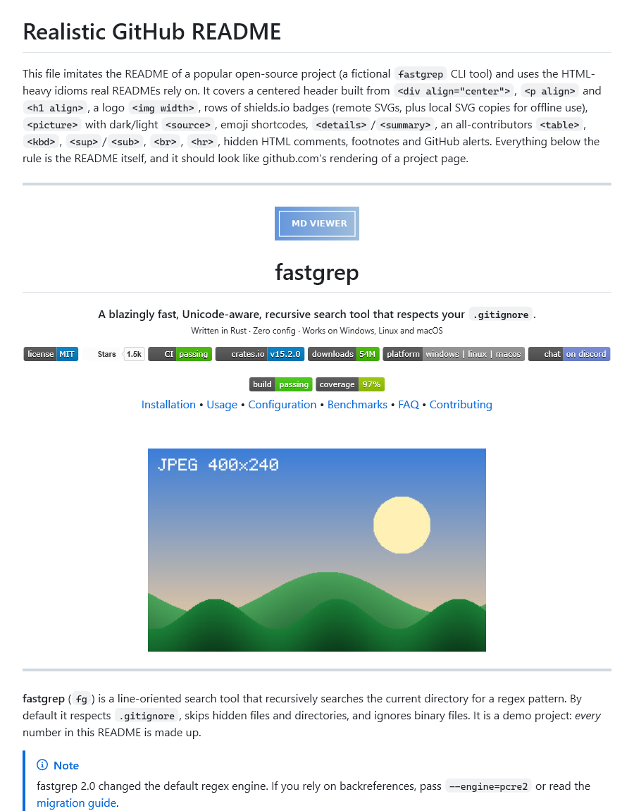
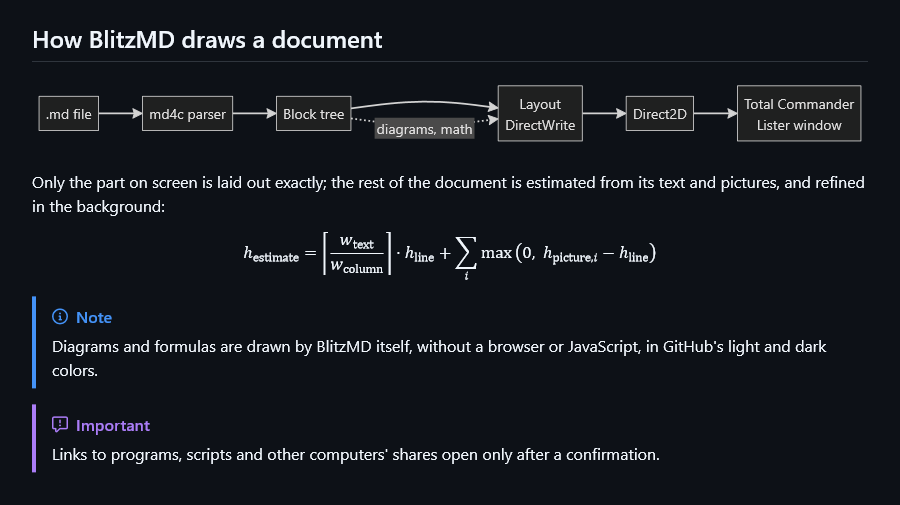
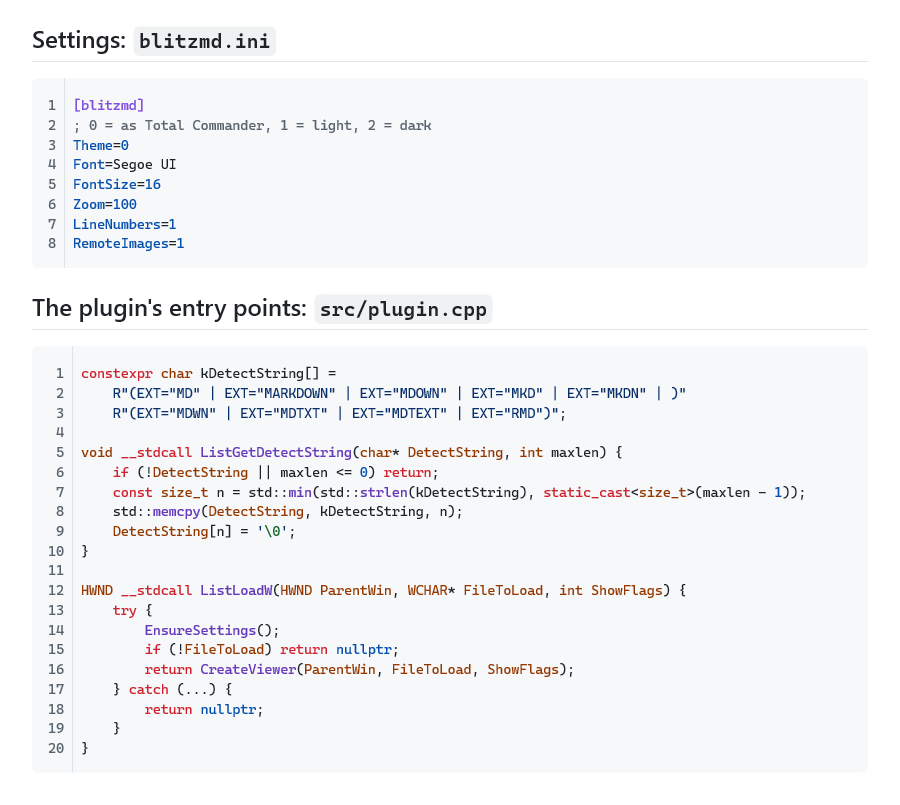

# mdview — просмотр Markdown для Total Commander

Lister-плагин (WLX) для Total Commander, который показывает `.md`-файлы по **F3** и в панели
быстрого просмотра (**Ctrl+Q**) так, как их рисует GitHub: полная поддержка
[GitHub Flavored Markdown](https://github.github.com/gfm/), расширения GitHub (alerts, сноски,
формулы, эмодзи) и HTML-вставки, которые встречаются в README.

Рендеринг — собственный движок на **Direct2D + DirectWrite** (без браузера, без RichEdit): быстро,
с аккуратной типографикой и минимальным расходом памяти. Разбор Markdown —
[md4c](https://github.com/mity/md4c).

| Светлая тема | Тёмная тема |
|---|---|
|  |  |



## Возможности

**GitHub Flavored Markdown** — все конструкции спецификации GFM 0.29: заголовки ATX/Setext,
абзацы, цитаты, списки (маркированные, нумерованные с любым начальным номером, вложенные,
«тесные» и «свободные»), списки задач `- [x]`, блоки кода (fenced и с отступом), таблицы с
выравниванием, зачёркивание, ссылки всех видов (inline, reference, autolink, расширенные
autolink `www.` / `https://` / e-mail), изображения, HTML-сущности, экранирование, жёсткие
переносы. Проверено официальным набором тестов спецификации (см. «Тестирование»).

**Расширения GitHub**
- Alerts: `> [!NOTE]`, `[!TIP]`, `[!IMPORTANT]`, `[!WARNING]`, `[!CAUTION]` — с иконками Octicons.
- Сноски `[^1]`, включая многоабзацные (с кодом и списками внутри), с обратными ссылками ↩.
- Формулы `$…$`, `$$…$$` и блоки ```` ```math ````: TeX переводится в Unicode-математику
  (курсивные переменные, греческие буквы, индексы и степени, дроби, корни, матрицы).
- Эмодзи-коды `:rocket:` → 🚀 (полная база GitHub gemoji, 1900+ кодов), цветные эмодзи.
- Якоря заголовков как на GitHub (`#установка`, дубликаты `-1`, `-2`), переходы по ним.
- Подсветка синтаксиса в блоках кода: ~70 языков (250+ названий и расширений: C/C++, C#, Java,
  Kotlin, Swift, Go, Rust, JS/TS, Python, Ruby, PHP, Lua, SQL, Pascal/Delphi, Bash, PowerShell,
  bat, HTML/XML, CSS, JSON, YAML, TOML, INI, diff, Dockerfile, Makefile, CMake, ассемблер, LaTeX
  и другие), цвета как на GitHub.
- Изображения только для тёмной/светлой темы: `#gh-dark-mode-only`, `<picture><source media>`.
- YAML front matter в начале файла (Jekyll, Hugo, Docusaurus) показывается таблицей, как на GitHub.

**HTML, который используют README**: `<div align="center">`, `<p align>`, `<h1 align>`,
``, `<picture>`, `<details>`/`<summary>` (раскрываются кликом),
`<kbd>`, `<sup>`, `<sub>`, `<mark>`, `<ins>`, `<del>`, `<br>`, `<hr>`, `<a name>`, HTML-таблицы
(`colspan`), `<dl>`, комментарии. `<script>`, `<style>`, `<iframe>` и подобное не выполняется и не
показывается.

**Изображения**: PNG, JPEG, GIF, BMP, ICO, TIFF, WebP (через WIC), SVG (включая текст и логотипы —
бейджи shields.io и GitHub Actions выглядят как на GitHub), `data:`-URI, относительные и абсолютные
пути, пробелы и кириллица в именах файлов. Анимированные GIF проигрываются (только пока видны на
экране; кадры декодируются по одному, без хранения всей анимации в памяти). Картинки из интернета
загружаются в фоне и кешируются (отключаемо). Память под картинки ограничена (192 МБ, в 32-битной
версии 96 МБ): в документах с сотнями скриншотов давно не показанные картинки выгружаются и
декодируются заново, когда снова попадают на экран.

**Просмотр**
- Тема следует Total Commander (включая тёмный режим TC 10+), можно задать светлую/тёмную явно.
- Плавная прокрутка, собственная полоса прокрутки с отметками найденного текста.
- Выделение мышью (двойной щелчок — слово, тройной — абзац), копирование (Ctrl+C, меню TC).
- Поиск через стандартный диалог Lister (F7, F3 / Shift+F3): регистр, целые слова, назад;
  все совпадения подсвечиваются, свёрнутые `<details>` раскрываются.
- Ссылки: веб-ссылки открываются в браузере, `#якоря` прокручивают документ, ссылки на другие
  `.md` открываются в этом же окне (назад — Backspace или Alt+←), остальные файлы — связанным
  приложением. Адрес ссылки показывается во всплывающей подсказке внизу окна.
- Широкие таблицы и (при выключенном переносе) длинный код прокручиваются по горизонтали
  (Shift+колесо), у блоков кода есть кнопка «Копировать».
- Номера строк в блоках кода (включаются в контекстном меню); при копировании кода их нет.
- Масштаб Ctrl+колесо / Ctrl+`+` / Ctrl+`-` / Ctrl+0 (сохраняется).
- Процент прокрутки в заголовке Lister, переход к проценту из меню TC.
- Печать (меню Lister «Файл → Печать»): разбивка на страницы без разрыва строк и строк таблиц.
- Эскизы для режима просмотра эскизов Total Commander.
- Контекстное меню: оглавление документа (переход к любому заголовку), копирование, адрес
  ссылки/картинки, копирование блока кода, тема, перенос кода, номера строк в коде, ширина текста,
  загрузка картинок из сети, перезагрузка (F5), открыть в редакторе.
- Щелчок по картинке (не ссылке) открывает изображение в программе просмотра, как на GitHub.
- Кодировки: UTF-8 (с BOM и без), UTF-16 LE/BE (с BOM и без), ANSI (например, Windows-1251).
- Документы любого размера: многомегабайтный файл открывается за доли секунды — точная
  разметка строится только для видимой части, остальное уточняется в фоне.

## Установка

1. Скачайте `mdview.zip` (в нём `mdview.wlx64` для 64-битного и `mdview.wlx` для 32-битного TC).
2. Откройте архив в Total Commander (Enter на файле) — TC предложит установить плагин.
3. Готово: F3 или Ctrl+Q на `.md` файле.

Вручную: распакуйте в любую папку и добавьте `mdview.wlx64` в
*Конфигурация → Настройка → Плагины → Плагины просмотра (WLX)*.

Требования: Windows 10/11 (на Windows 7/8.1 плагин загружается, но не тестировался; SVG там
недоступен). Внешних зависимостей нет — только системные библиотеки.

## Управление

| Клавиша / действие | Что делает |
|---|---|
| ↑ ↓, PgUp PgDn, Пробел / Shift+Пробел, Home End | Прокрутка |
| Колесо / Shift+колесо | Прокрутка / горизонтальная прокрутка широкой таблицы или кода |
| Ctrl+колесо, Ctrl+`+`, Ctrl+`-`, Ctrl+0 | Масштаб |
| Ctrl+A, Ctrl+C | Выделить всё, копировать |
| Щелчок по ссылке | Открыть ссылку / перейти к якорю / открыть `.md` |
| Backspace, Alt+← | Назад после перехода по ссылке |
| Щелчок по `<summary>` | Раскрыть / свернуть `<details>` |
| F5 | Перечитать файл |
| F7, F3, Shift+F3 | Поиск (диалог Lister) |
| N, P, Esc, 1–7 … | Стандартные клавиши Lister (обрабатывает Total Commander) |

## Настройки

Хранятся в `mdview.ini` рядом с `wincmd.ini` (секция `[mdview]`). Файл создаётся, когда что-то
меняется через контекстное меню; все ключи необязательны.

| Ключ | По умолчанию | Описание |
|---|---|---|
| `Theme` | `0` | `0` — как в Total Commander (или Windows), `1` — светлая, `2` — тёмная |
| `Font` | `Segoe UI` | Шрифт текста |
| `MonoFont` | *(авто)* | Моноширинный шрифт; по умолчанию Cascadia Mono, иначе Consolas |
| `FontSize` | `16` | Базовый размер шрифта (как 16px на GitHub) |
| `Zoom` | `100` | Масштаб в процентах (30–400) |
| `MaxWidth` | `900` | Максимальная ширина текста; `0` — на всю ширину окна |
| `WrapCode` | `-1` | Перенос длинных строк кода: `-1` — как «Перенос строк» в Lister, `0`/`1` — выкл/вкл |
| `LineNumbers` | `0` | Номера строк в блоках кода (из двух и более строк) |
| `RemoteImages` | `1` | Загружать картинки из интернета (http/https) |
| `SmoothScroll` | `1` | Плавная прокрутка |
| `EmojiShortcodes` | `1` | Заменять `:код:` на эмодзи |
| `Math` | `1` | Формулы `$…$` |
| `SyntaxHighlight` | `1` | Подсветка синтаксиса |
| `HardwareRendering` | `0` | `1` — рисовать через GPU (имеет смысл для очень больших окон, 4K); по умолчанию программный Direct2D: быстрее открывается и расходует меньше памяти |

## Сборка

Нужны Visual Studio 2022/2026 с компонентом C++ и CMake (идёт с VS). Всё остальное лежит в
репозитории (md4c — в `third_party`), сеть при сборке не нужна.

```powershell
# x64 Release -> out\build\x64-release\mdview.wlx64
powershell -File scripts\build.ps1

# x64 + x86 и упаковка в dist\mdview.zip (для установки из TC)
powershell -File scripts\build.ps1 -Arch all -Package
```

Можно также открыть папку проекта в Visual Studio (CMake-пресеты `x64-release`, `x86-release`).

## Тестирование

Инструмент `mdview_test.exe` собирается вместе с плагином:

```powershell
$t = "out\build\x64-release\mdview_test.exe"
& $t spec tests\spec\gfm-spec.txt           # тесты спецификации GFM 0.29 (672 примера)
& $t spec tests\spec\commonmark-spec.txt    # тесты CommonMark 0.31.2
& $t render samples\gfm\02-github-readme.md out.png --width 900 [--dark] [--zoom 1.5]
& $t pages  samples\gfm\05-tables.md page   # постраничная разбивка как при печати
& $t bench  samples\gfm\09-large-document.md
& $t fuzz   2000                            # случайные документы: разбор + разметка + отрисовка
& $t plugin out\build\x64-release\mdview.wlx64 README.md shot.png "поиск"   # сам DLL, как TC
& $t plugin out\build\x64-release\mdview.wlx64 anim.md shot.png --idle      # + расход CPU в простое (GIF)
out\build\x64-release\highlight_test.exe -q   # подсветка синтаксиса: 1.4 млн проверок, фаззинг
out\build\x64-release\emoji_test.exe          # таблица эмодзи-кодов
```

Результат по спецификации GFM: все 604 примера, не связанных с «сырым» HTML, совпадают с
эталоном (примеры с HTML намеренно интерпретируются, а не выводятся как есть). Прогон под
AddressSanitizer (`-DMDVIEW_ASAN=ON`) и фаззинг чисты.

`samples/gfm/` — набор документов для визуальной проверки: обзор всей спецификации, README
в стиле GitHub, alerts/сноски/формулы, 45+ языков кода, таблицы, списки, типографика
на 15+ языках (включая RTL), пограничные случаи и документ на 2.5 МБ.

## Архитектура

```
src/plugin.cpp        экспорт WLX: ListLoad(W), ListLoadNext(W), ListSearchText(W),
                      ListSendCommand, ListPrint(W), ListGetPreviewBitmap(W), ...
src/core/parser.*     md4c → дерево блоков; HTML-подмножество GitHub, эмодзи, якоря, сноски
src/core/html.*       токенизатор HTML
src/core/texmath.*    TeX → Unicode
src/core/highlight.*  подсветка синтаксиса
src/core/layout.*     разметка: DirectWrite, точная у видимой части, оценка остального
src/core/render.*     отрисовка Direct2D (темы GitHub Primer)
src/core/images.*     WIC, SVG, фоновая загрузка по http(s) с кешем
src/core/viewer.*     окно Lister: прокрутка, выделение, ссылки, поиск, меню
src/core/print.*      печать
third_party/md4c      md4c 0.6.0 с несколькими правками совместимости с GitHub
```

## Лицензия

MIT (см. `LICENSE`). Используются: [md4c](https://github.com/mity/md4c) (MIT),
данные [gemoji](https://github.com/github/gemoji) (MIT), иконки
[Octicons](https://github.com/primer/octicons) (MIT).
