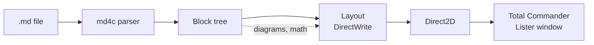

## How BlitzMD draws a document



Only the part on screen is laid out exactly; the rest of the document is estimated from its text
and pictures, and refined in the background:

```math
h_\text{estimate} = \left\lceil \frac{w_\text{text}}{w_\text{column}} \right\rceil \cdot h_\text{line} + \sum_{i} \max\left(0,\; h_{\text{picture}, i} - h_\text{line}\right)
```

> [!NOTE]
> Diagrams and formulas are drawn by BlitzMD itself, without a browser or JavaScript, in GitHub's
> light and dark colors.

> [!IMPORTANT]
> Links to programs, scripts and other computers' shares open only after a confirmation.
