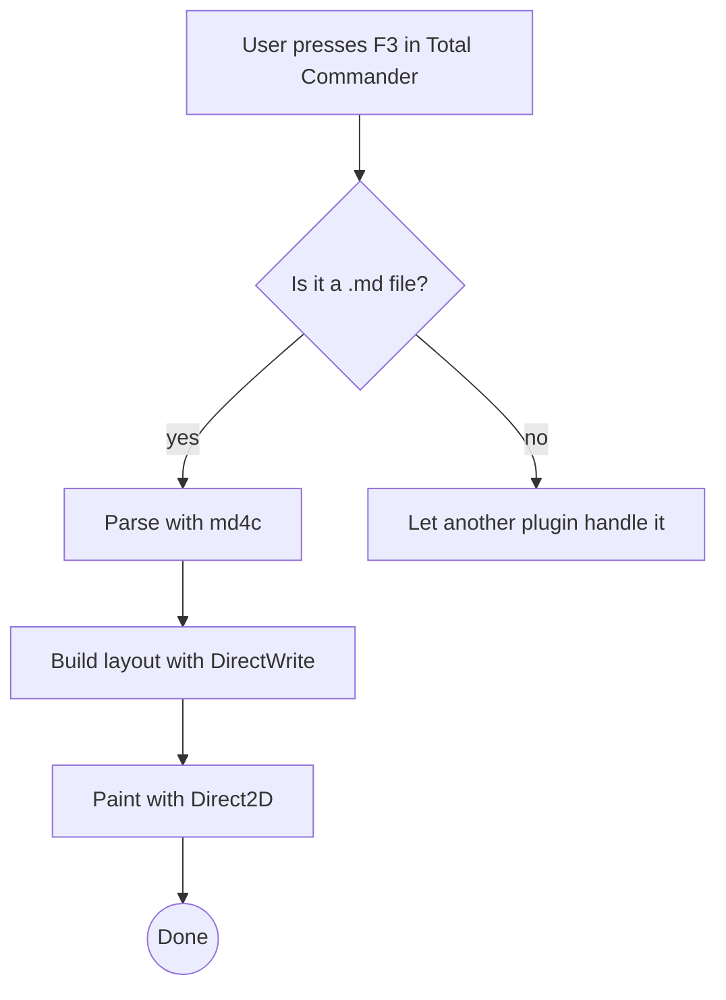
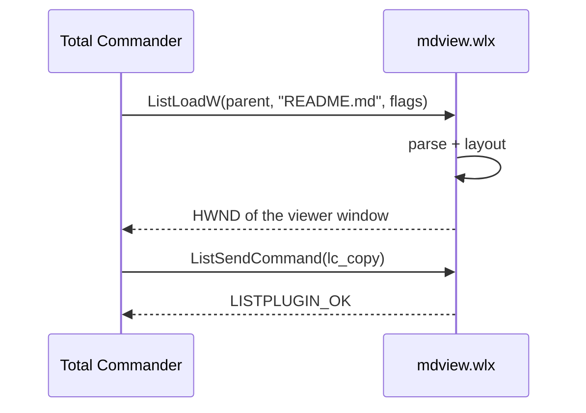
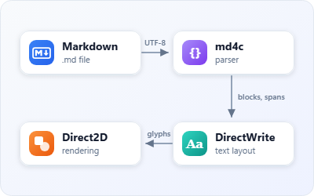
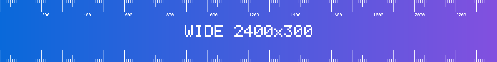
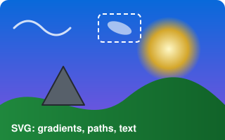
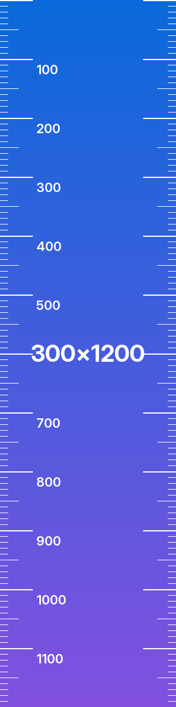

# GitHub Extensions and HTML Extras

This file covers what github.com renders beyond the GFM spec: alerts (`> [!NOTE]` and friends), footnotes, emoji shortcodes, math, Mermaid diagrams, and the whitelisted HTML elements READMEs commonly use. It also covers HTML anchors, `align` attributes, `` sizing and floating, every image format in `img/`, and relative links between files in this folder. Invalid or unsupported syntax sits next to the valid syntax and is labeled, so you can see what must stay literal.

## Contents

1. [Alerts](#alerts)
2. [Footnotes](#footnotes)
3. [Emoji](#emoji)
4. [Math](#math)
5. [Diagrams and other rich code blocks](#diagrams-and-other-rich-code-blocks)
6. [Non-GFM syntax that must stay literal](#non-gfm-syntax-that-must-stay-literal)
7. [Inline HTML elements](#inline-html-elements)
8. [HTML headings, anchors and alignment](#html-headings-anchors-and-alignment)
9. [Images: sizes, alignment and formats](#images-sizes-alignment-and-formats)
10. [Links between files](#links-between-files)

---

## Alerts

### The five alert types

> [!NOTE]
> Useful information that users should know, even when skimming content.

> [!TIP]
> Helpful advice for doing things better or more easily.

> [!IMPORTANT]
> Key information users need to know to achieve their goal.

> [!WARNING]
> Urgent info that needs immediate user attention to avoid problems.

> [!CAUTION]
> Advises about risks or negative outcomes of certain actions.

### Alerts with rich content

> [!NOTE]
> **Multi-paragraph alert.** The first paragraph has *emphasis*, `inline code` and a [link](#footnotes).
>
> The second paragraph is separated by a `>` line with nothing else on it. Long text must wrap inside the colored left border, and the wrapped lines must stay aligned with the alert's text, not with the border. Lorem ipsum dolor sit amet, consectetur adipiscing elit, sed do eiusmod tempor incididunt ut labore et dolore magna aliqua.
>
> - A bullet list inside the alert
> - with a second item
>   - and a nested item
>
> 1. An ordered list
> 2. inside the alert

> [!TIP]
> Code blocks inside alerts keep their own background:
>
> ```powershell
> Get-ChildItem -Recurse -Filter *.md |
>     Where-Object Length -gt 1MB |
>     Sort-Object Length -Descending
> ```
>
> Tables work too:
>
> | Shortcut | Action |
> |----------|--------|
> | <kbd>F3</kbd> | Open Lister |
> | <kbd>N</kbd> | Next file |

> [!IMPORTANT]
> # A heading inside an alert
> Followed by text, then a nested quote:
>
> > A regular block quote nested inside the alert.

> [!WARNING]
> The alert contains an image:
>
> 

> [!CAUTION]
> A single line with a lazy continuation
that has no `>` marker but still belongs to the alert paragraph.

### Case and syntax variants

Lower- and mixed-case types are **valid**. github.com and md4c (`MD_FLAG_ADMONITIONS`) both match the type case-insensitively:

> [!note]
> Lowercase `[!note]`: renders as a NOTE alert.

> [!Warning]
> Mixed-case `[!Warning]`: renders as a WARNING alert.

### Invalid alerts: these must render as ordinary block quotes

> [!DANGER]
> Unknown type `DANGER`: a plain quote whose first line is the literal text "[!DANGER]".

> [!INFO]
> Unknown type `INFO` (Docusaurus/Obsidian use it, GitHub doesn't).

> [!NOTE] Text on the same line as the marker
> Anything else on the marker line makes this a plain quote.

> [! NOTE]
> A space after the `!`: plain quote.

> [NOTE]
> The `!` is missing: plain quote (and `[NOTE]` is literal text).

> Some text first.
> [!NOTE]
> The marker isn't on the first line: plain quote.

> **[!NOTE]**
> The marker is wrapped in bold: plain quote.

An empty alert, just the marker line with no content (implementation-dependent: either an empty alert box or a plain quote showing `[!TIP]`):

> [!TIP]

An alert inside a list item (implementation-dependent: note whether the viewer renders an alert or a plain quote):

- List item
  > [!NOTE]
  > Is this an alert or a quote?

---

## Footnotes

Here is a simple footnote[^1]. Here is a named footnote[^note], whose label is never shown because footnotes are numbered in order of first use. The first footnote again[^1]: its definition must show **two** back-references (↩ ↩). Then a long footnote with several blocks[^long], a footnote with a hyphenated label[^my-note_2], and one defined *before* it is used[^early].

[^early]: This definition appears in the source before its reference. It still renders at the bottom, numbered by first use.

Footnote references in other contexts:

- In a list item[^list].
- In **bold text[^bold]**.
- Right after a link: [md4c](https://github.com/mity/md4c)[^link].

| Column | With footnote |
|--------|---------------|
| A | Value in a table cell[^table] |

An undefined label stays literal text: [^missing]. A caret inside a normal link isn't a footnote: [^ not a footnote](https://example.com).

[^1]: This is footnote one. It is referenced twice.
[^note]: Named footnote. The label `note` is replaced by a number.
[^long]: This footnote has several paragraphs and blocks.

    Paragraphs indented by four spaces belong to the footnote.

    ```python
    def answer():
        return 42  # code block inside a footnote
    ```

    - A list inside the footnote
    - with two items
[^my-note_2]: Labels may contain hyphens and underscores.
[^list]: Referenced from a list item.
[^bold]: Referenced from inside `**bold**` text.
[^link]: Referenced right after a link.
[^table]: Referenced from a table cell.
[^unused]: This definition is never referenced, so it must **not** appear in the footnote list.

---

## Emoji

### Shortcodes :tada:

Shortcodes should work in headings (see the :tada: above), in paragraphs :smile:, and **in bold :fire:** or *italic :sparkles:* text.

- :white_check_mark: Done
- :x: Failed
- :warning: Warning
- :hourglass_flowing_sand: In progress
- :+1: :-1: :100: :1st_place_medal: :heart: :broken_heart: :eyes: :rocket: :bug: :memo: :lock: :key:
- Flags: :ukraine: :de: :jp: :us: :gb: :fr: :brazil: :kr: :cn: :ru: :es: :it: :canada: :india: :checkered_flag: :rainbow_flag: :pirate_flag:
- People and skin tones via shortcodes: :wave: :raised_hands: :technologist: :woman_astronaut: :family_man_woman_girl_boy:

| Status | Meaning |
|:------:|---------|
| :green_circle: | Operational |
| :yellow_circle: | Degraded |
| :red_circle: | Outage |
| :large_blue_diamond: | Maintenance |

GitHub's **custom** emoji are images, not Unicode, so a Unicode-only emoji table (gemoji's `emoji.json`) won't know them: :octocat: :shipit: :atom: :electron: :bowtie: :neckbeard: :trollface:

### Things that look like shortcodes but aren't

These must stay as literal text:

- Unknown shortcodes: :not_an_emoji: and :foo_bar_baz:
- Times and ratios: the meeting is at 10:30:45, the ratio is 16:9:4, and the build ran from 09:15 to 11:45.
- Missing colon: :smile and smile:
- Spaces inside: : smile : and :smi le:
- Inside code: `:smile:` and a code block:

  ```text
  :rocket: in a code block is never converted
  ```

- Inside a URL: https://example.com/:rocket:/path (the link text may convert on github.com, but the href must not change)
- Escaped colons: \:rocket\: (implementation-defined: the backslashes disappear, and github.com converts emoji only *after* Markdown parsing, so it may still show 🚀)
- IPv6 address: fe80::1ff:fe23:4567:890a and C++ scope `std::vector` in prose: std::vector

### Unicode emoji typed directly

Basic: 😀 😂 🥲 😍 🤔 🙃 🤖 👻 💩 🎉 🔥 ✨ 🚀 ⭐ 🌍 🍕 ☕ 🐛

Skin tones: 👍 👍🏻 👍🏼 👍🏽 👍🏾 👍🏿 and 👋🏻 👋🏿

ZWJ sequences (each should be a **single** glyph): 👨‍👩‍👧‍👦 👩‍💻 👩🏽‍💻 🧑‍🚀 👨‍❤️‍👨 🏳️‍🌈 🏳️‍⚧️ 🏴‍☠️ 🐻‍❄️ ❤️‍🔥 😶‍🌫️

Flags (regional-indicator pairs): 🇺🇦 🇯🇵 🇩🇪 🇺🇸 🇬🇧 🇫🇷 🇧🇷 🇰🇷 🇨🇳 🇪🇺 🇺🇳 and a subdivision tag sequence (Scotland): 🏴󠁧󠁢󠁳󠁣󠁴󠁿

Keycaps: 0️⃣ 1️⃣ 2️⃣ #️⃣ *️⃣ 🔟

Text vs emoji presentation: ☺ vs ☺️, ❤ vs ❤️, ✔ vs ✔️, ☀ vs ☀️, ↔ vs ↔️, © vs ©️

Newer emoji (Unicode 14 and 15; they may be missing from older fonts): 🫠 🫡 🫶 🥹 🪿 🫎 🩷 🪼 🫨

Emoji inside other markup: **bold 🔥**, *italic 🚀*, ~~struck 🐛~~, `code 🙂`, [link 🔗](#emoji)

---

## Math

GitHub renders math with MathJax. A viewer without math support should at least show the TeX source unchanged, including backslashes, carets and underscores (`_` here must **not** start emphasis).

Inline math: the mass-energy relation $E = mc^2$, the Pythagorean identity $\sin^2\theta + \cos^2\theta = 1$, and a fraction $\frac{a_1 + a_2}{b_1 \cdot b_2}$ inside a sentence.

Inline math with backtick delimiters (avoids conflicts with markdown): $`\sqrt{x^2 + y^2}`$

Display math on one line:

$$\sum_{i=1}^n i = \frac{n(n+1)}{2}$$

Display math over several lines:

$$
\begin{aligned}
\nabla \cdot \vec{E} &= \frac{\rho}{\varepsilon_0} \\
\nabla \times \vec{B} - \frac{1}{c^2}\frac{\partial \vec{E}}{\partial t} &= \mu_0 \vec{J}
\end{aligned}
$$

A `math` fenced block:

```math
\int_{-\infty}^{\infty} e^{-x^2}\,dx = \sqrt{\pi}
\qquad
\mathbf{A} = \begin{pmatrix} 1 & 2 \\ 3 & 4 \end{pmatrix}
```

Dollar signs that are **not** math: this costs $5 and that costs $10. An escaped dollar: \$HOME. Shell variables in code: `echo $PATH $HOME`.

---

## Diagrams and other rich code blocks

GitHub renders these fenced blocks as diagrams, maps or 3D models. mdview draws Mermaid diagrams itself (see [20-mermaid-flowchart.md](20-mermaid-flowchart.md), [21-mermaid-sequence.md](21-mermaid-sequence.md) and [22-mermaid-class.md](22-mermaid-class.md)); diagram types it can't draw yet stay code with a note saying so, and maps and 3D models stay ordinary code blocks.

A Mermaid flowchart:



A Mermaid sequence diagram:



GeoJSON (shown as a map on github.com):

```geojson
{
  "type": "FeatureCollection",
  "features": [
    { "type": "Feature", "properties": { "name": "Kyiv" },
      "geometry": { "type": "Point", "coordinates": [30.5234, 50.4501] } }
  ]
}
```

---

## Non-GFM syntax that must stay literal

These come from other Markdown flavors and are **not** GitHub syntax. Each one should appear exactly as typed.

- Highlight: ==highlighted text== (Obsidian, markdown-it-mark)
- Superscript: 19^th^ and 2^10^ (Pandoc)
- Pandoc subscript H~2~O. Careful: on github.com a single-tilde pair is **strikethrough**, so the "2" shows struck through.
- Insert: ++inserted++ (markdown-it-ins)
- Spoiler: ||spoiler text|| (Discord)
- Wiki links: [[Some Page]] and [[Page|label]]
- Attribute lists: *text*{.red #id} (the braces stay literal, but *text* is still italic)
- Table-of-contents macros: [TOC] and [[_TOC_]] (on github.com the underscores italicize "TOC")

**Abbreviation definition** (PHP Markdown Extra). This renders as a plain paragraph:

*[HTML]: Hyper Text Markup Language

**Definition list** (PHP Markdown Extra). This renders as one paragraph whose second line starts with a colon:

Term
: Definition

**MkDocs admonition.** An indented line can't interrupt a paragraph, so both lines render as one paragraph:

!!! note "Title"
    Admonition body.

---

## Inline HTML elements

| Element | Rendered | Notes |
|---------|----------|-------|
| `<mark>` | <mark>highlighted</mark> | yellow background |
| `<ins>` | <ins>inserted</ins> | underline |
| `<del>` | <del>deleted</del> | strikethrough |
| `<s>` | <s>no longer accurate</s> | strikethrough |
| `<u>` | <u>underlined</u> | underline |
| `<small>` | normal <small>small text</small> normal | smaller font |
| `<abbr>` | <abbr title="World Health Organization">WHO</abbr> | dotted underline, tooltip |
| `<var>` | <var>x</var> = <var>y</var> + 2 | italic |
| `<samp>` | <samp>Segmentation fault (core dumped)</samp> | monospace |
| `<kbd>` | <kbd>Ctrl</kbd>+<kbd>Alt</kbd>+<kbd>Del</kbd> | key caps |
| `<q>` | <q>quoted inline</q> | adds quotation marks |
| `<cite>` | <cite>The Art of Computer Programming</cite> | italic |
| `<dfn>` | <dfn>Markdown</dfn> is a markup language | italic |
| `<sup>` / `<sub>` | x<sup>2</sup> + y<sub>i</sub> | raised / lowered |
| `<b>` / `<i>` | <b>bold</b> / <i>italic</i> | |
| `<strong>` / `<em>` | <strong>strong</strong> / <em>em</em> | |
| `<code>` | <code>inline code</code> | monospace with background |
| `<tt>` | <tt>teletype</tt> | monospace (obsolete element) |
| `<ruby>` | <ruby>漢<rp>(</rp><rt>kan</rt><rp>)</rp>字<rp>(</rp><rt>ji</rt><rp>)</rp></ruby> | ruby annotation |
| `<span style>` | <span style="color: red">not red on GitHub</span> | `style` is stripped by GitHub |
| `<font color>` | <font color="red">not red on GitHub</font> | stripped |
| `<br>` | line one<br>line two | line break inside a cell |

A definition list:

<dl>
  <dt>Lister</dt>
  <dd>The Total Commander file viewer, opened with <kbd>F3</kbd>.</dd>
  <dt>WLX plugin</dt>
  <dd>A DLL that adds a new file format to the Lister.</dd>
  <dd>A single term can have <b>several</b> definitions.</dd>
  <dt>md4c</dt>
  <dt>MD4C</dt>
  <dd>Several terms can share one definition. This is the Markdown parser.</dd>
</dl>

An HTML block quote with a citation:

<blockquote>
  <p>Premature optimization is the root of all evil.</p>
  <footer>— <cite>Donald Knuth</cite></footer>
</blockquote>

A `<details>` block with markdown inside and a nested `<details>`:

<details>
<summary>Outer summary with <b>bold</b> and <code>code</code></summary>

Markdown content: **bold**, a list:

- one
- two

<details>
<summary>Inner nested summary</summary>

```c
printf("nested details\n");
```

</details>

</details>

---

## HTML headings, anchors and alignment

<h3 id="custom-html-heading">An HTML heading with an explicit id</h3>

<h4 id="another-custom-id" align="center">A centered HTML h4 with an id</h4>

<a name="legacy-anchor"></a>
A named anchor (`<a name="legacy-anchor">`) sits right before this paragraph. It's the old-school way to make a jump target.

<a id="id-anchor"></a>**Bold text preceded by an empty `<a id>` anchor.**

Links to the anchors above (github.com prefixes ids with `user-content-`, but links still jump):

- [Jump to the custom HTML heading](#custom-html-heading)
- [Jump to the centered h4](#another-custom-id)
- [Jump to the `<a name>` anchor](#legacy-anchor)
- [Jump to the `<a id>` anchor](#id-anchor)
- [Jump to the "Alerts" markdown heading](#alerts)
- [Jump to "Shortcodes :tada:" (GitHub builds the anchor from the shortcode text, so it is `#shortcodes-tada`)](#shortcodes-tada)

<p align="right">This paragraph is <b>right-aligned</b> with <code>&lt;p align="right"&gt;</code>. Markdown such as *this* is <b>not</b> processed inside it, because it is one HTML block.</p>

<div align="center">

### A centered markdown heading

This **markdown** paragraph is centered by the enclosing `<div align="center">`. The blank lines around it are what turn markdown processing back on.

| Even | a table |
|------|---------|
| is   | centered |

</div>

<div align="right">

Right-aligned markdown: *emphasis*, `code`, and a [link](#html-headings-anchors-and-alignment).

</div>

<p align="center">
  <br>
  <em>A centered image with a caption underneath.</em>
</p>

---

## Images: sizes, alignment and formats

### Width and height attributes

| Markup | Result |
|--------|--------|
| `width="64"` (bare number) |  |
| `width="64px"` (with unit) |  |
| `height="24"` only |  |
| `width="200" height="40"` (distorted aspect ratio) |  |
| `width="50%"` |  |
| no attributes (intrinsic 200×80) |  |

A percentage width outside a table (should be 25% of the content width):



### Floating images: align="left" / align="right"


This paragraph wraps around an image floated right with `align="right"`. Lorem ipsum dolor sit amet, consectetur adipiscing elit. Sed do eiusmod tempor incididunt ut labore et dolore magna aliqua. Ut enim ad minim veniam, quis nostrud exercitation ullamco laboris nisi ut aliquip ex ea commodo consequat. Duis aute irure dolor in reprehenderit in voluptate velit esse cillum dolore eu fugiat nulla pariatur.


This paragraph wraps around an image floated left with `align="left"`. Excepteur sint occaecat cupidatat non proident, sunt in culpa qui officia deserunt mollit anim id est laborum. Curabitur pretium tincidunt lacus, nulla gravida orci a odio, et tempus feugiat. Integer vitae libero ac risus egestas placerat.

<br clear="both">

### Images wrapped in links

[](https://github.com/mity/md4c "Opens the md4c repository")

<a href="https://www.ghisler.com"></a> ← an HTML `` inside an HTML `<a>`

### Image formats

| Format | Image | File |
|--------|-------|------|
| PNG, RGBA transparency |  | `img/transparent.png` (160×160) |
| PNG, indexed + tRNS |  | `img/indexed-trns.png` (128×64, checkerboard holes are transparent) |
| JPEG (baseline) |  | `img/photo.jpg` (400×240) |
| GIF, animated (3 frames) |  | `img/animated.gif` (96×96, should cycle red, amber, green) |
| BMP, 24-bit |  | `img/palette.bmp` (160×100) |
| SVG with gradients, paths and `<text>` |  | `img/gradients.svg` (320×200) |
| SVG with viewBox only (no width/height) |  | `img/viewbox-only.svg` |
| SVG badges (shields.io layout, `<text>`) |   | `img/badge-*.svg` |

A HiDPI image: `img/hidpi@2x.png` is 400×160 and is displayed at `width="200"`. The 1-pixel hairlines should look crisp on a 200% display:


### Very wide and very tall images

A 2400×300 image must be scaled **down** to the content width (never wider than the window):


A 300×1200 image is displayed at its natural size (it's narrower than the content), and the document scrolls past it:



### File name with spaces and Cyrillic characters

The file on disk is `img/картинка с пробелами.png`. All four references below must show the **same** image:

1. Raw path in angle brackets: 
2. Spaces as `%20`, Cyrillic raw: 
3. Fully percent-encoded UTF-8: 
4. HTML `` with a raw path: 

### Broken and remote images

- A missing local file: 
- A missing file with no alt text: 
- Remote PNG: 
- Remote SVG badge: 
- Unreachable host: 

---

## Links between files

- [GFM spec tour](01-gfm-spec-tour.md)
- [A section in another file: spec tour, Tables](01-gfm-spec-tour.md#tables)
- [A deep anchor in another file: spec tour, Hard line breaks](01-gfm-spec-tour.md#hard-line-breaks)
- [The README of this folder](README.md "Index of all GFM samples (this title should appear as a tooltip)")
- [./-prefixed relative link](./04-code-highlighting.md)
- [Link into the parent folder](../sample-tables.md)
- [Link to a folder](img/)
- [Link to a non-markdown file (image)](img/gradients.svg)
- [Link with a title that should show as a tooltip](https://github.github.com/gfm/ "GitHub Flavored Markdown Spec: hover me!")
- [Reference link with a title][ref-with-title]

[ref-with-title]: 05-tables.md "Tables stress test (tooltip from a reference definition)"
