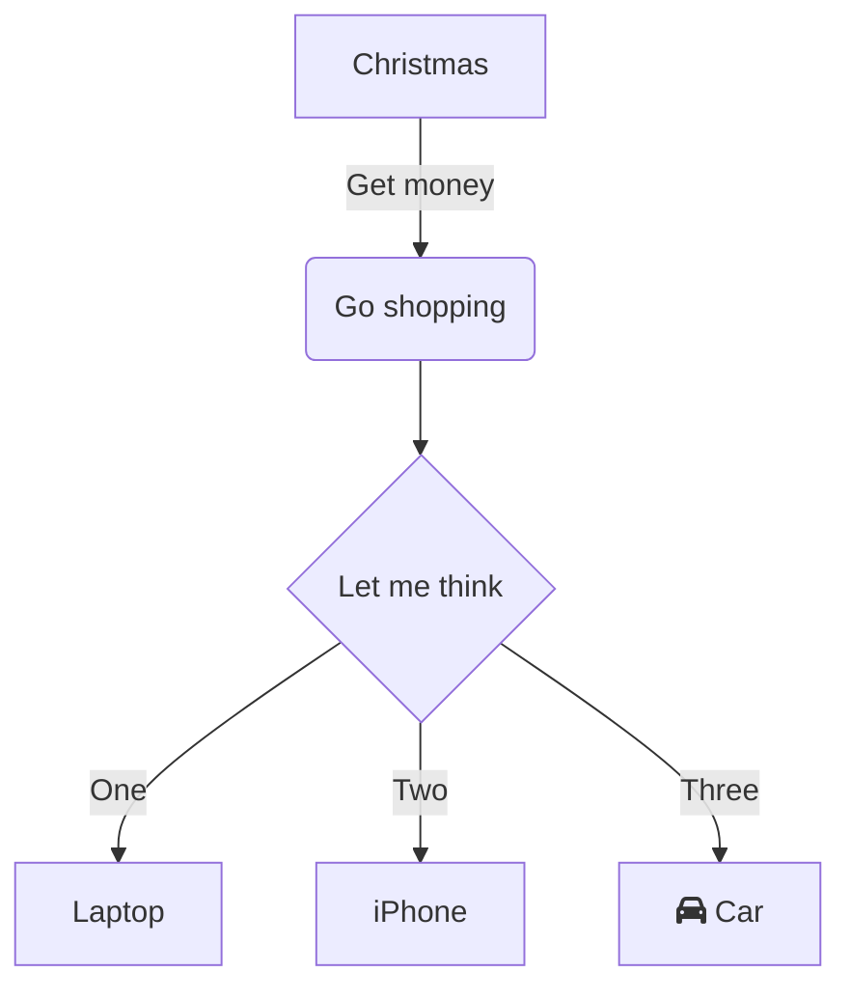
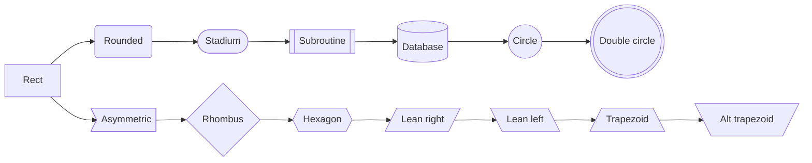
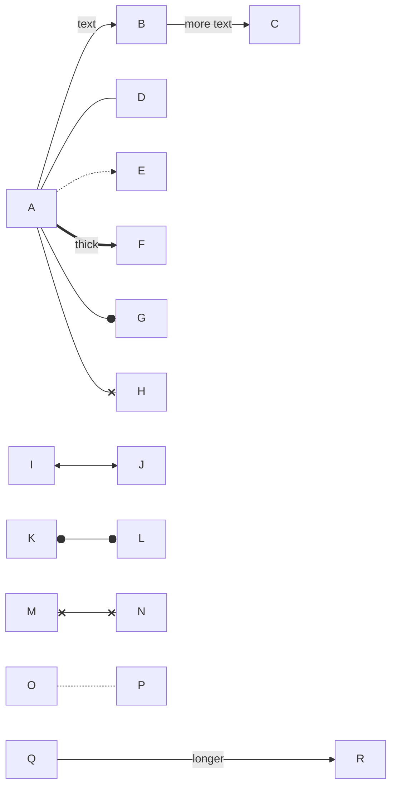
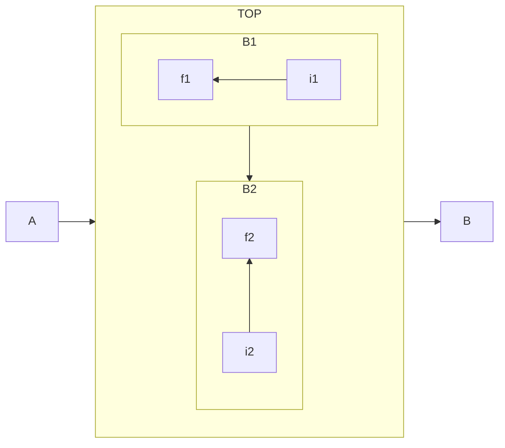
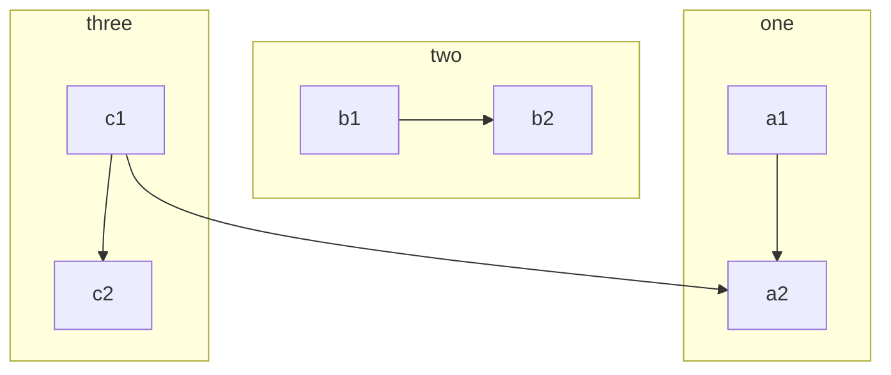
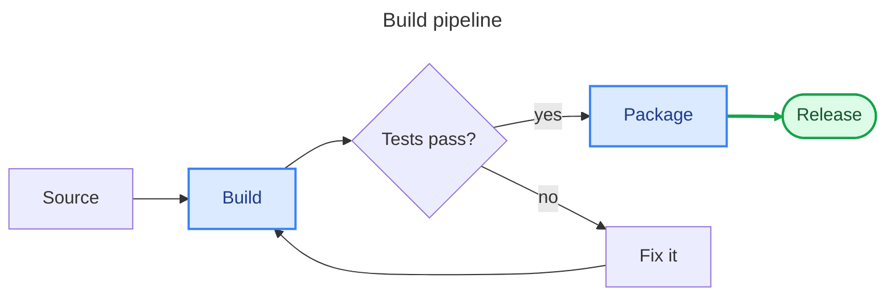
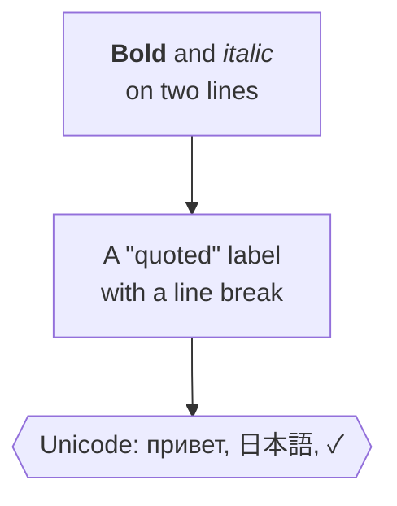
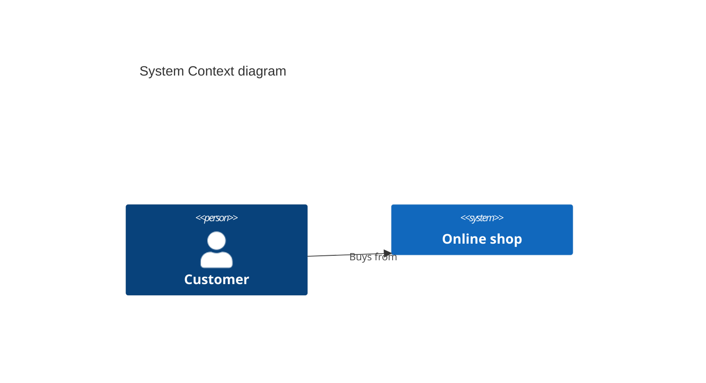

# Mermaid: flowcharts

GitHub draws ```` ```mermaid ```` blocks as diagrams. mdview lays them out itself (no browser, no JavaScript), in the colors of GitHub's light and dark Mermaid themes; like images, they zoom with Ctrl + wheel and open in the whole window. Copying a diagram gives its source, and search finds text on its labels.

## A decision



## Node shapes, left to right



## Links



## Subgraphs

Subgraphs that nothing links into from outside are laid out on their own, in their own direction:



Links crossing into subgraphs keep them side by side:



## A pipeline with styles



## Markdown in labels



## Not drawn

A diagram type mdview doesn't draw yet stays code, with a note:



So does a diagram with an error in it:

```mermaid
flowchart TD
    A[Unclosed --> B
```
