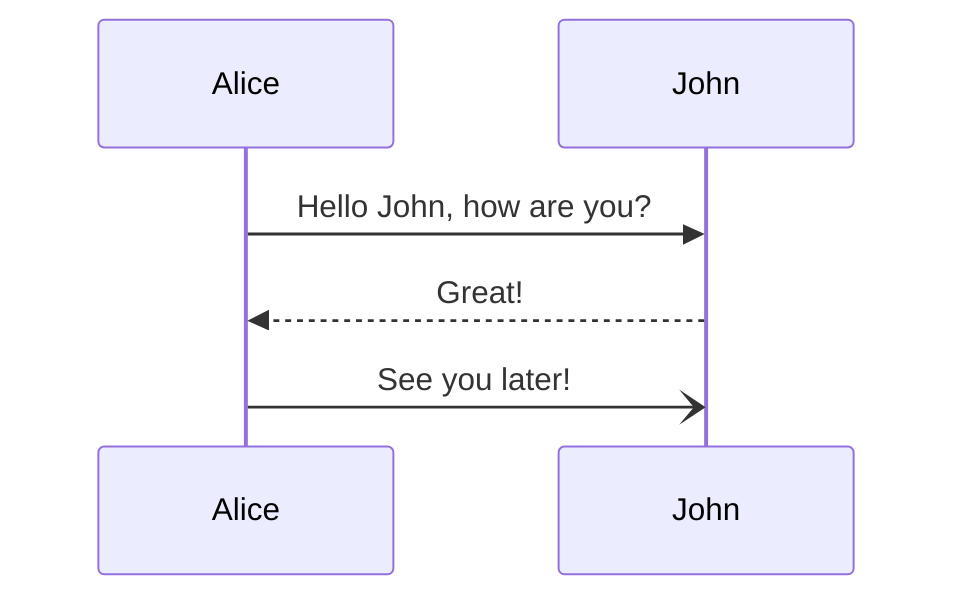
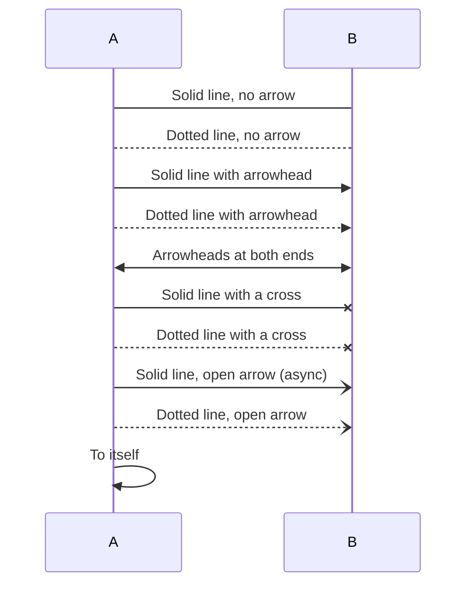
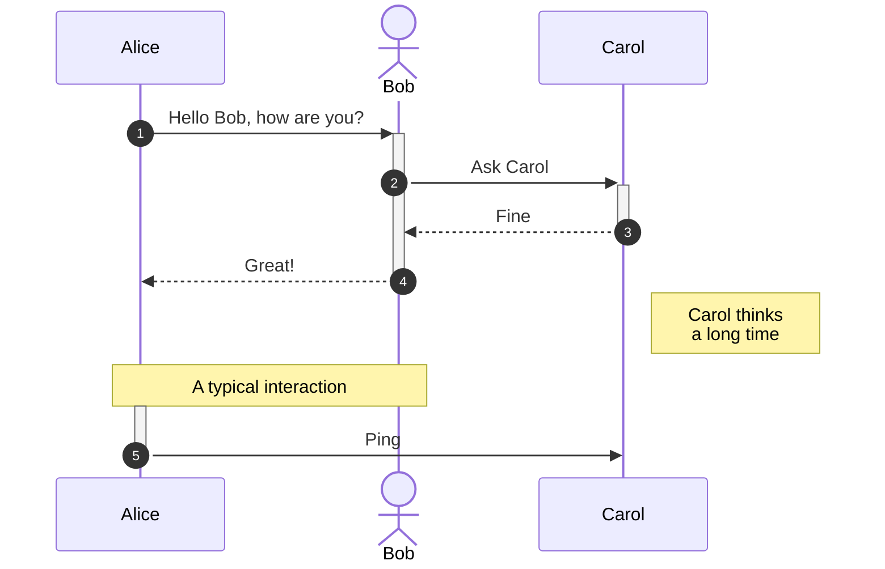
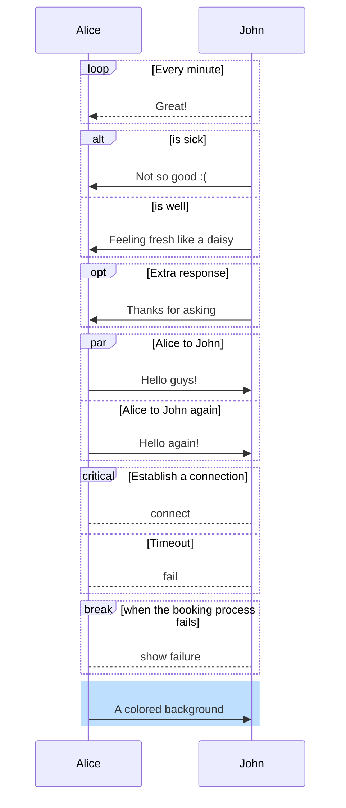
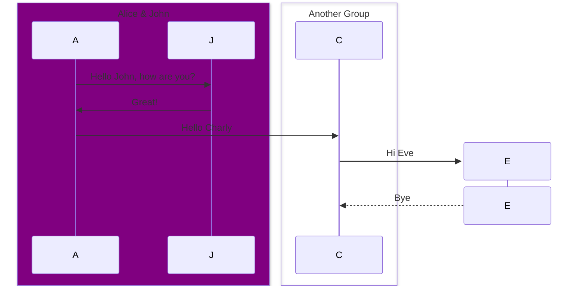
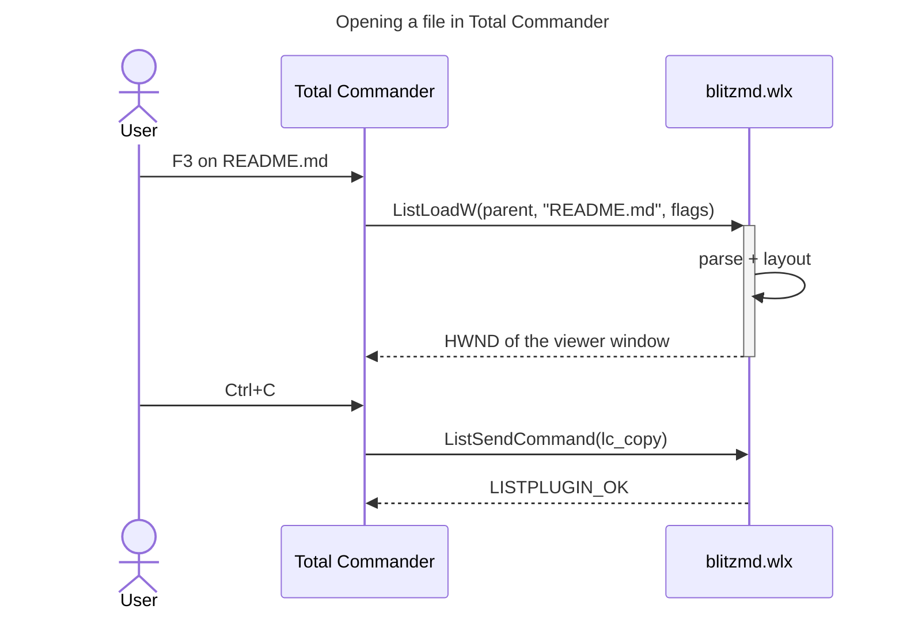

# Mermaid: sequence diagrams

Sequence diagrams drawn natively, like the flowcharts in [20-mermaid-flowchart.md](20-mermaid-flowchart.md).

## Messages

## Every arrow

## Actors, activations, notes, numbers

## Blocks

## Boxes, creating and destroying

## A real one

