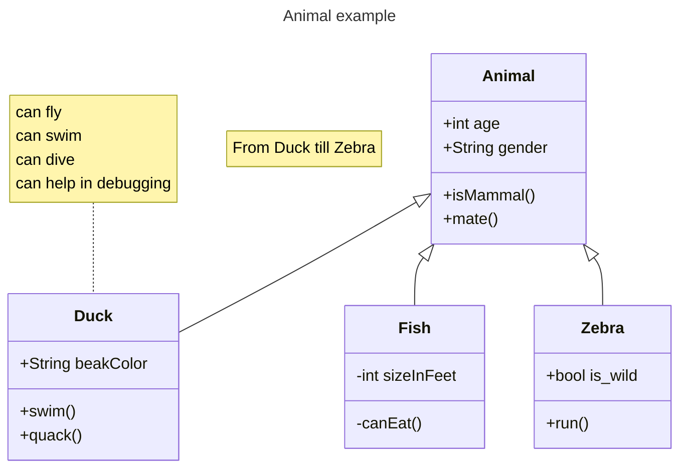
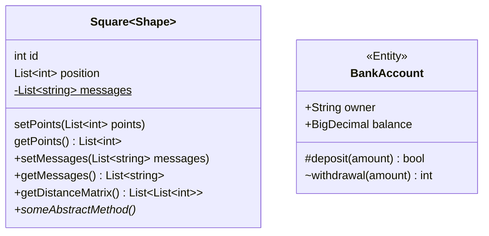
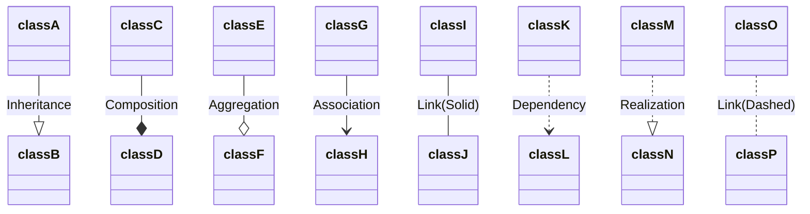
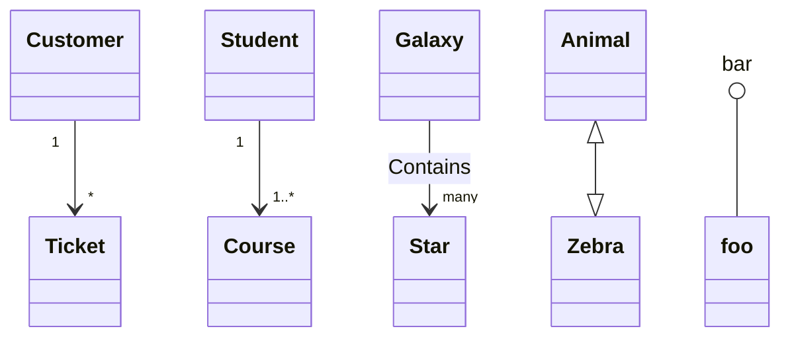
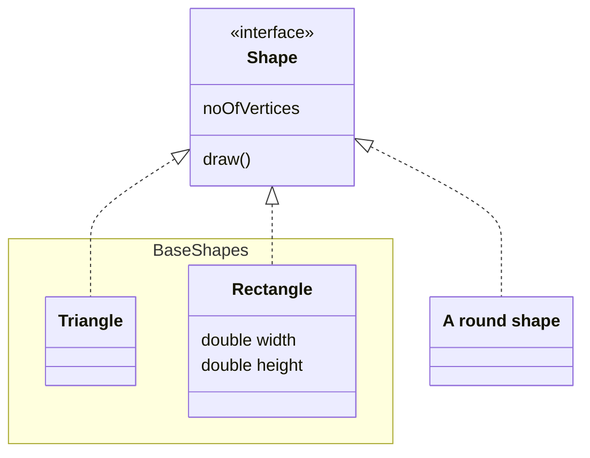
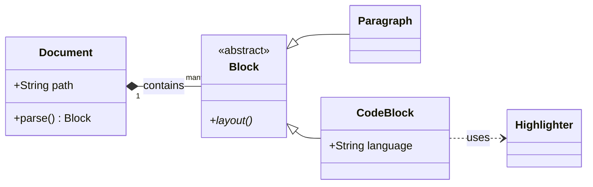

# Mermaid: class diagrams

Class diagrams drawn natively, like the flowcharts in [20-mermaid-flowchart.md](20-mermaid-flowchart.md) and the sequence diagrams in [21-mermaid-sequence.md](21-mermaid-sequence.md).

## Classes and inheritance

## Members: visibility, generics, static and abstract

## Every relation

## Cardinality, two-way relations and lollipops

## Annotations, namespaces and styles

## Left to right

