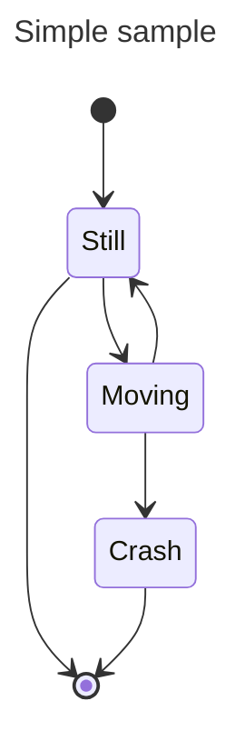
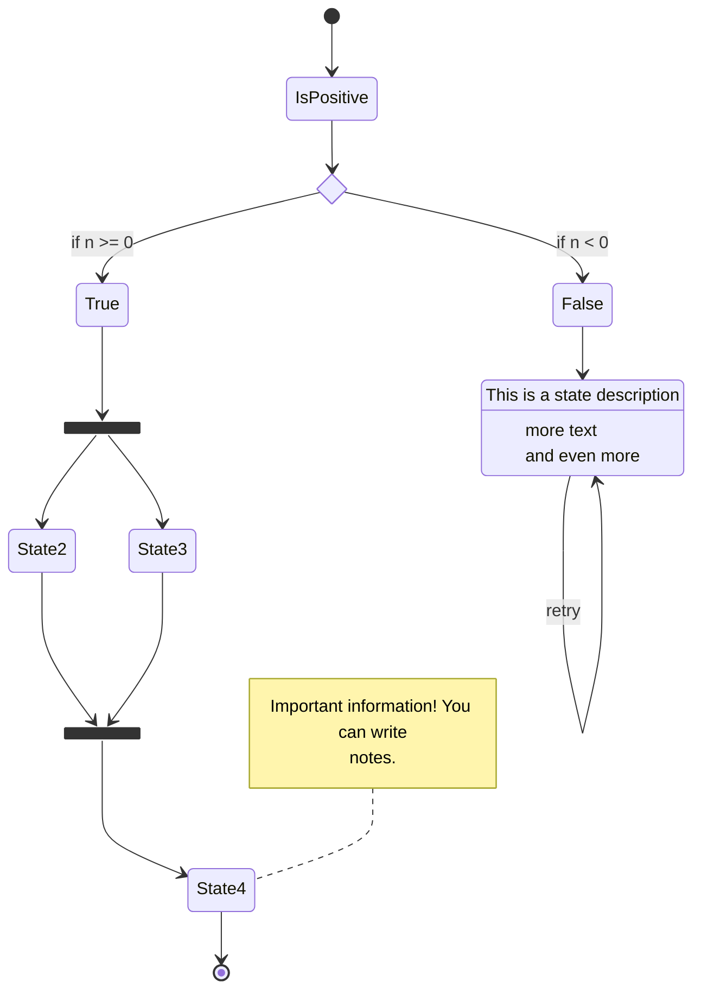
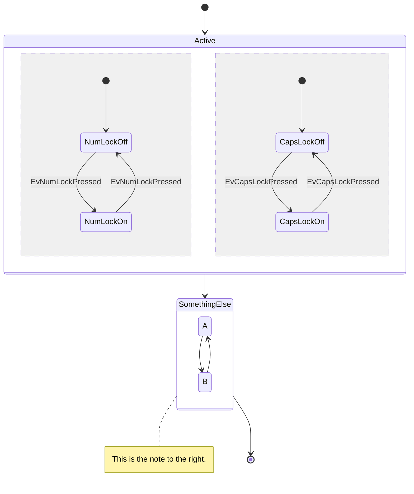
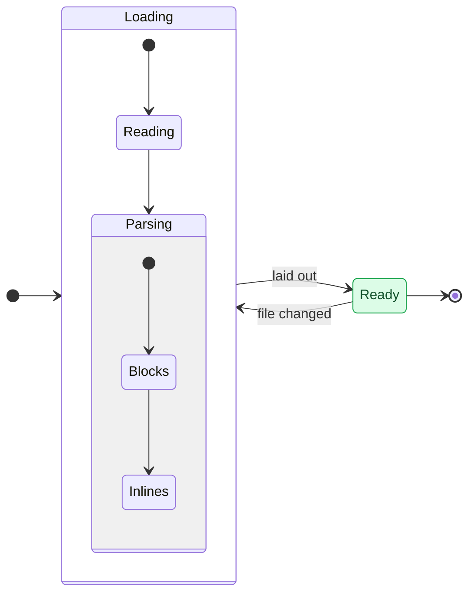

# Mermaid: state diagrams

State diagrams drawn natively, like the other Mermaid diagrams in [20-mermaid-flowchart.md](20-mermaid-flowchart.md), [21-mermaid-sequence.md](21-mermaid-sequence.md) and [22-mermaid-class.md](22-mermaid-class.md).

## States and transitions

## Descriptions, choices, forks and notes

## Composite states and concurrency

## Nested composites, left to right, styles

