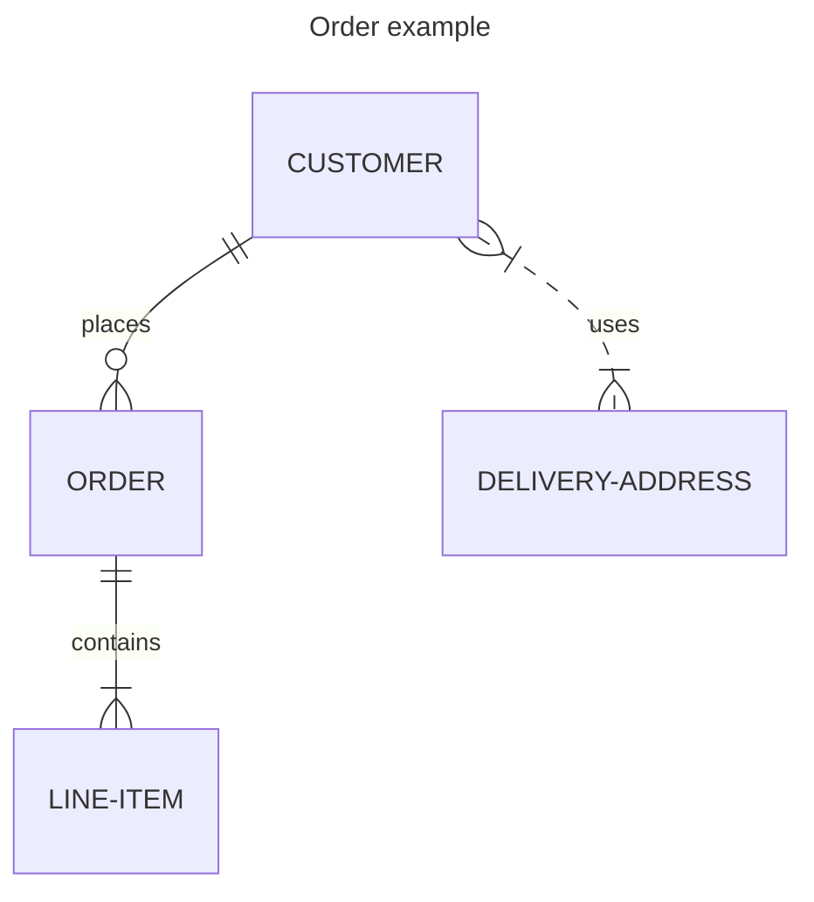
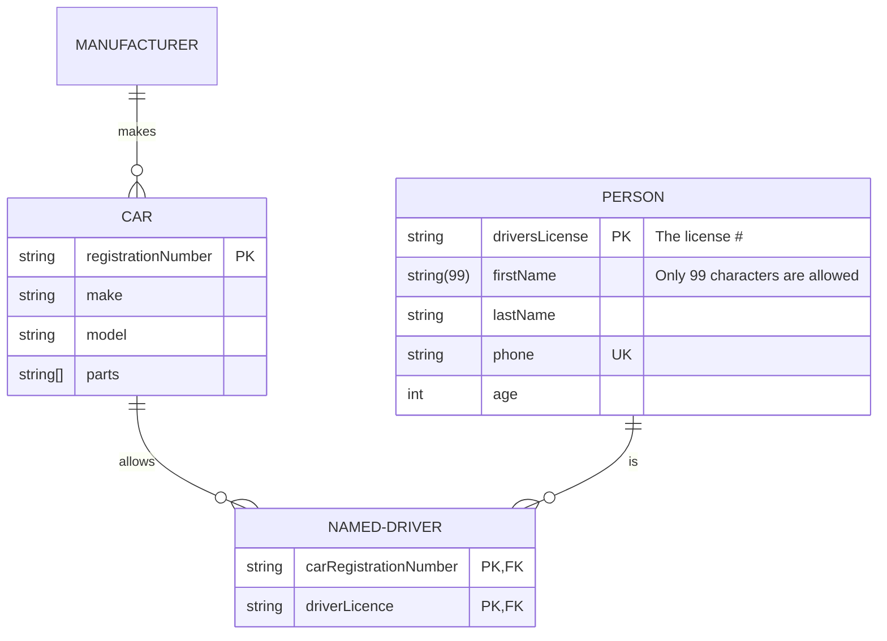
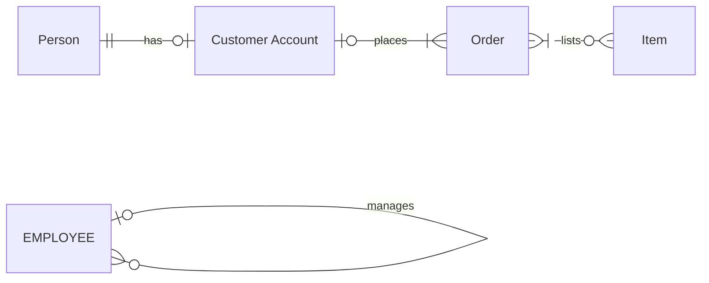
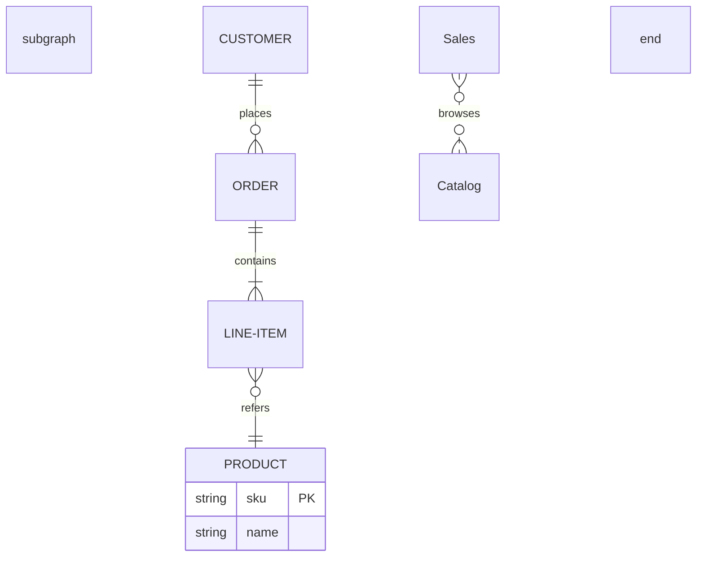

# Mermaid: entity relationship diagrams

Entity relationship diagrams drawn natively, like the other Mermaid diagrams in [20-mermaid-flowchart.md](20-mermaid-flowchart.md) to [23-mermaid-state.md](23-mermaid-state.md).

## Entities and relationships

## Attributes, keys and comments

## Every cardinality, aliases, left to right

## Subgraphs

