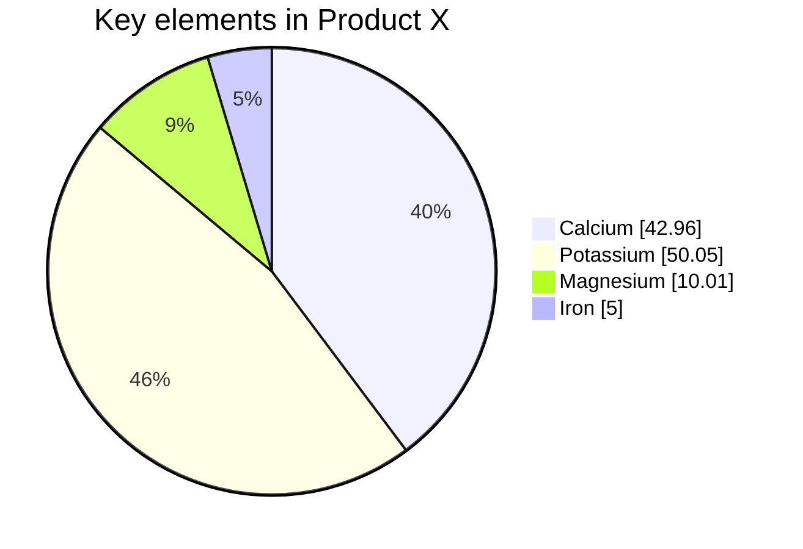
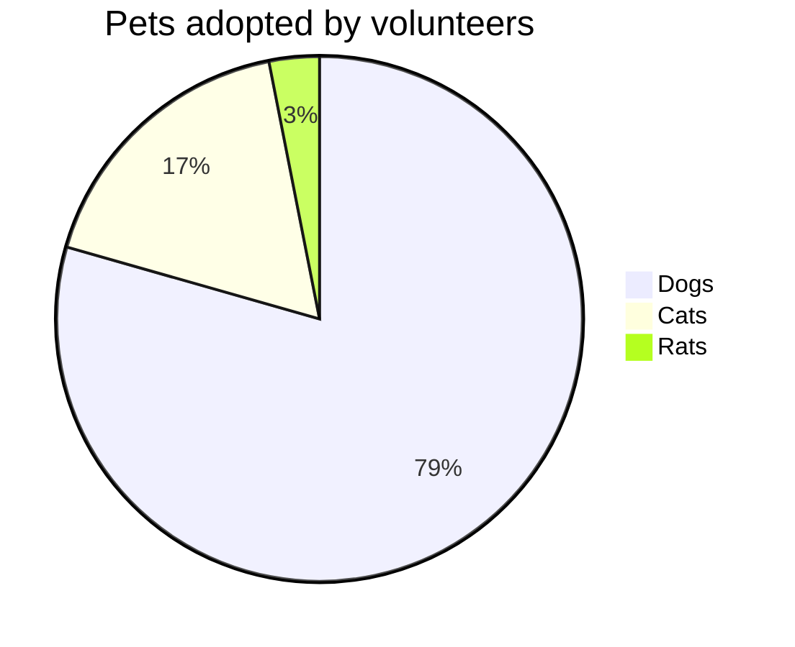
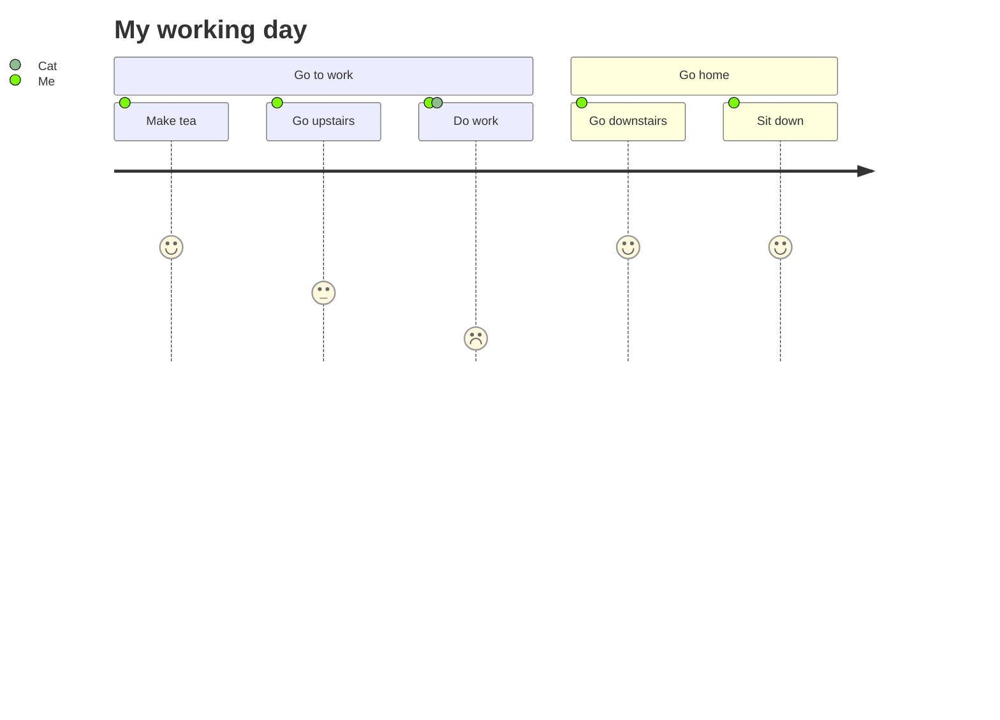
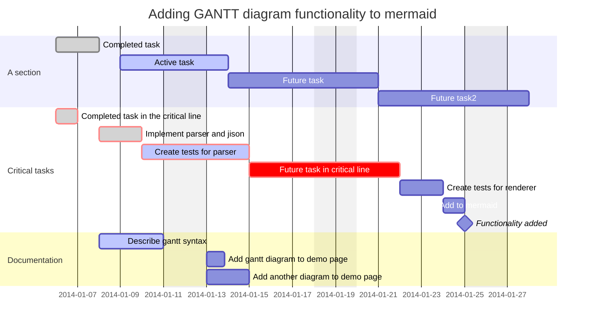
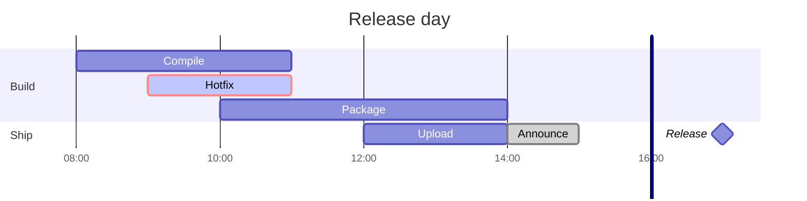
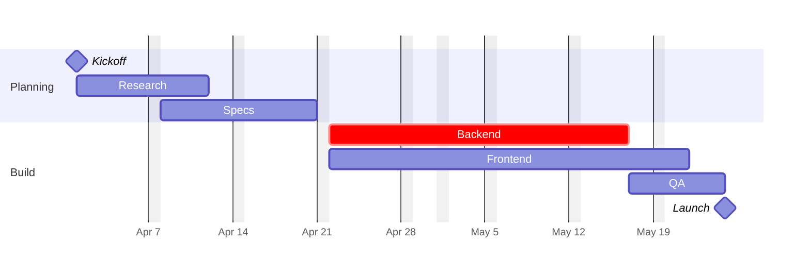

# Mermaid: pie charts, user journeys and Gantt charts

Charts drawn natively, like the other Mermaid diagrams in [20-mermaid-flowchart.md](20-mermaid-flowchart.md) to [24-mermaid-er.md](24-mermaid-er.md).

## Pie chart

## Pie chart with a front matter title

## User journey

## Gantt chart

## Gantt chart: hours, compact rows, a marker

## Gantt chart: other date formats, holidays, "until"

