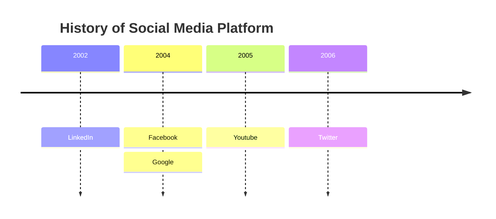
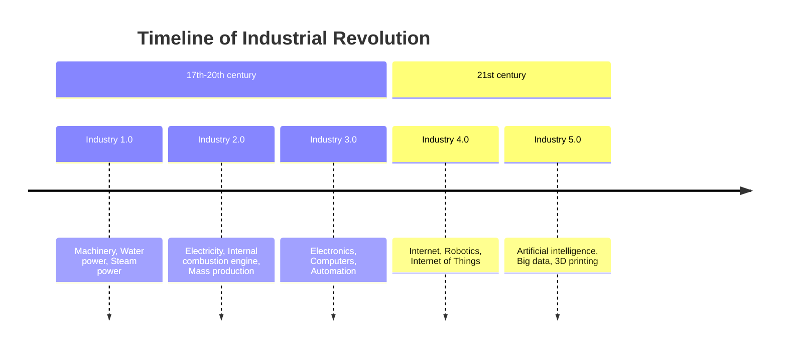
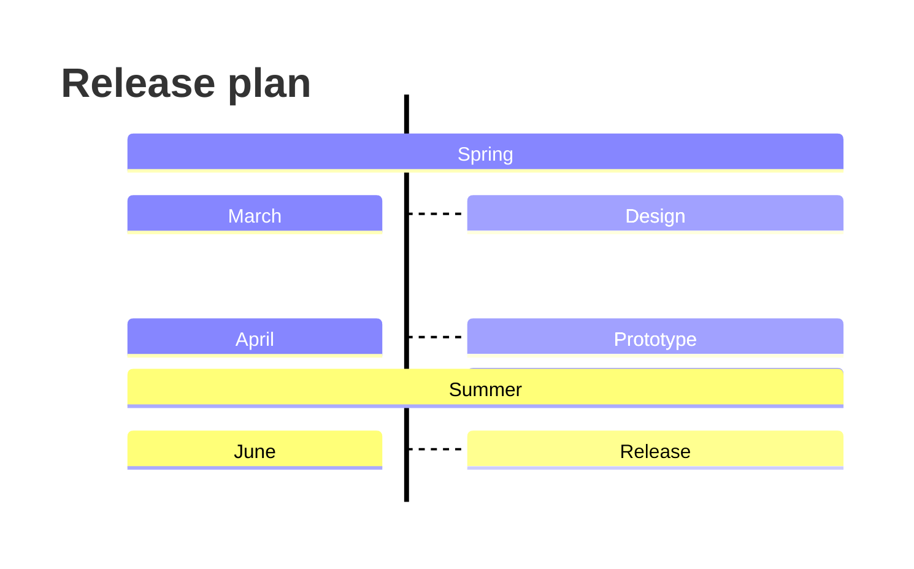
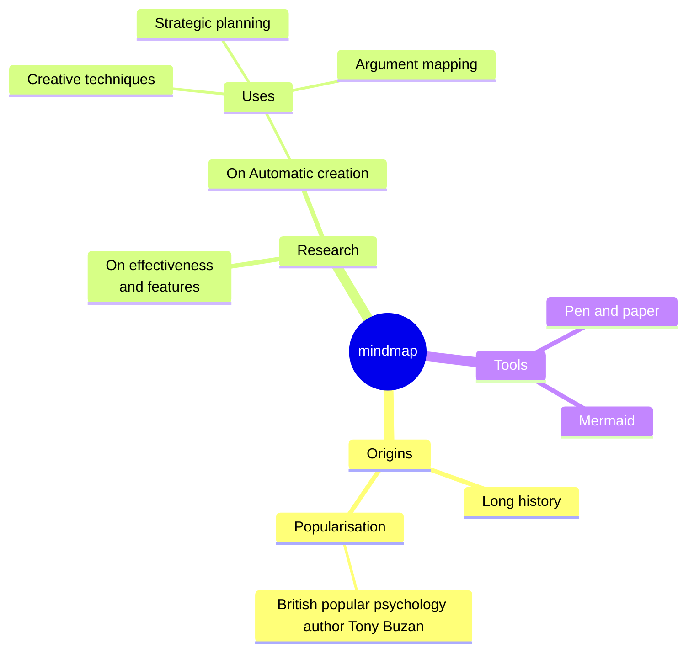
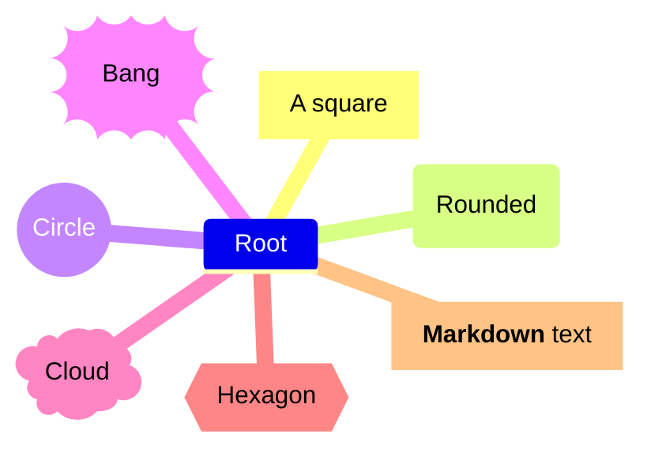
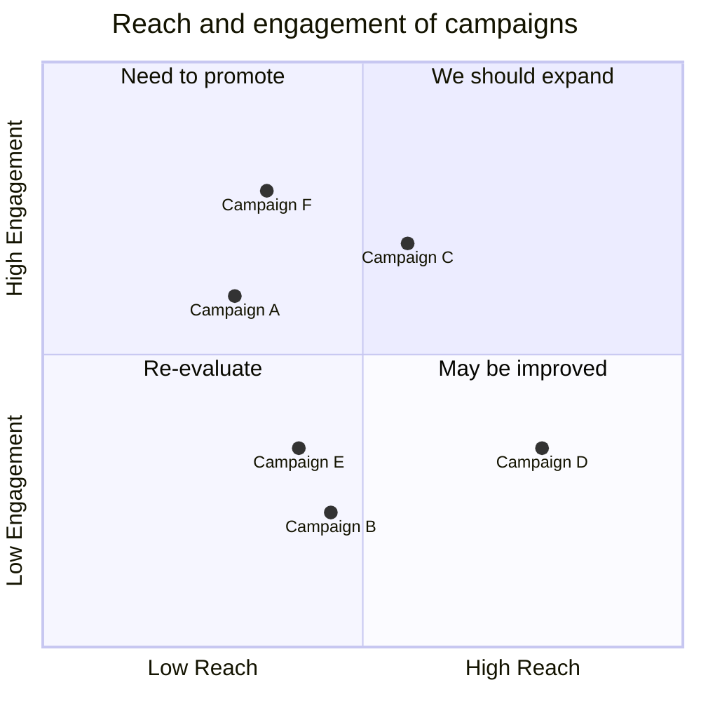
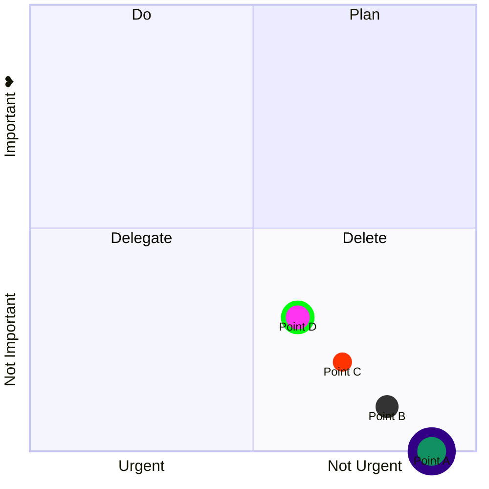
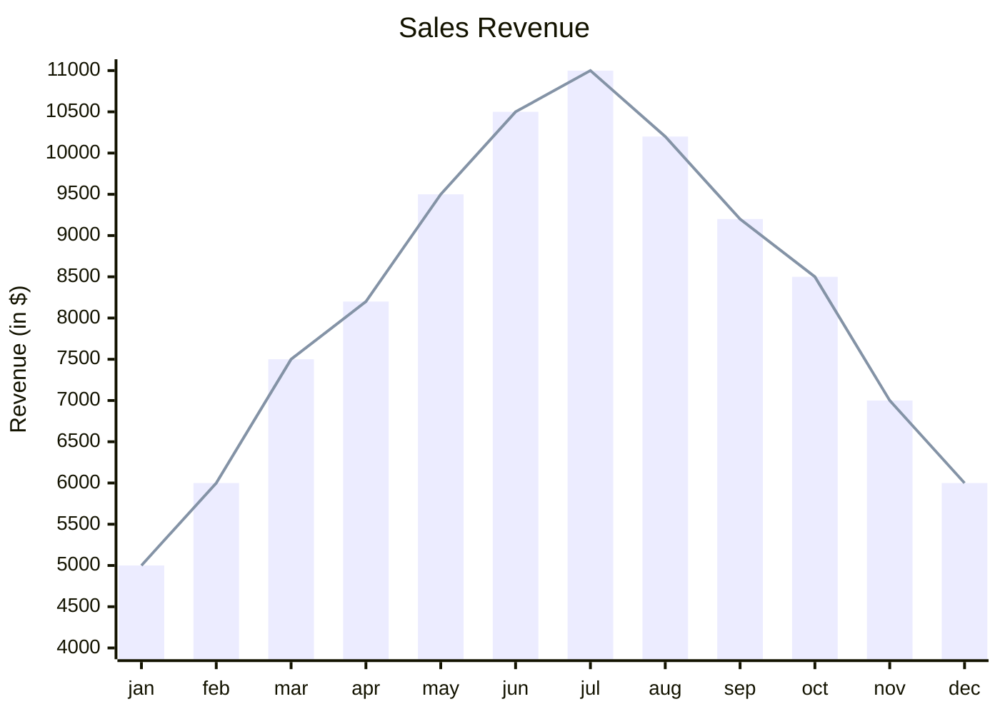
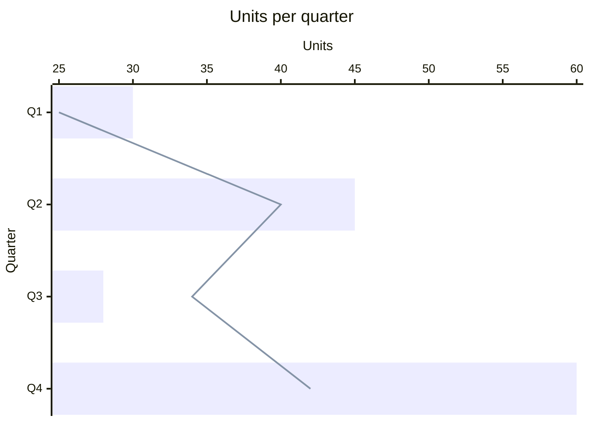

# Mermaid: timelines, mindmaps, quadrant charts and XY charts

More diagrams drawn natively, like the others in [20-mermaid-flowchart.md](20-mermaid-flowchart.md) to [25-mermaid-charts.md](25-mermaid-charts.md).

## Timeline

## Timeline with sections

## Timeline, top to bottom

## Mindmap

## Mindmap node shapes

## Quadrant chart

## Quadrant chart with styled points

## XY chart

## XY chart, horizontal, with a legend

