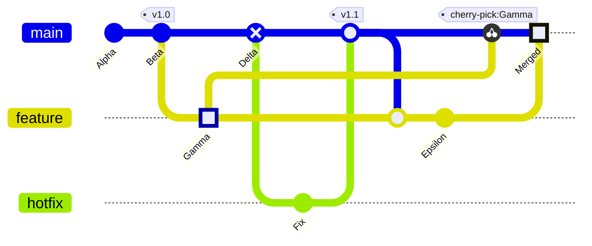
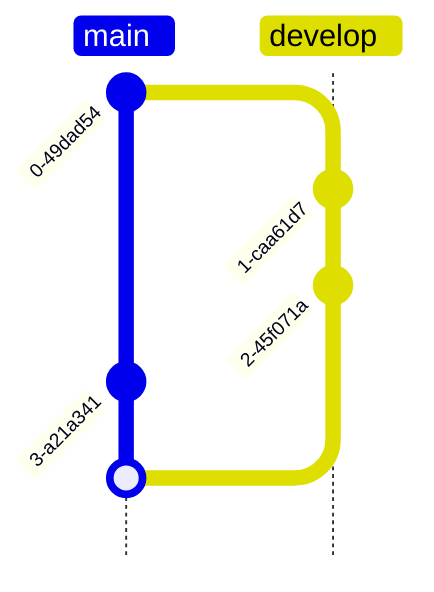
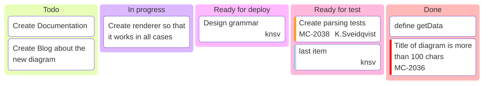
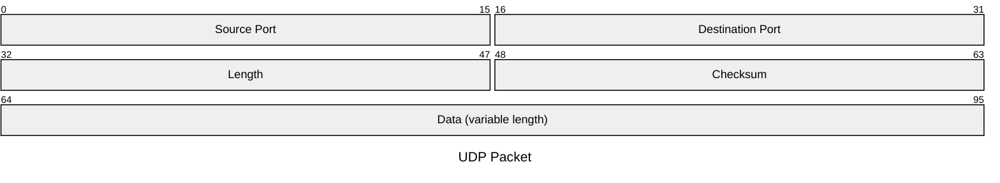
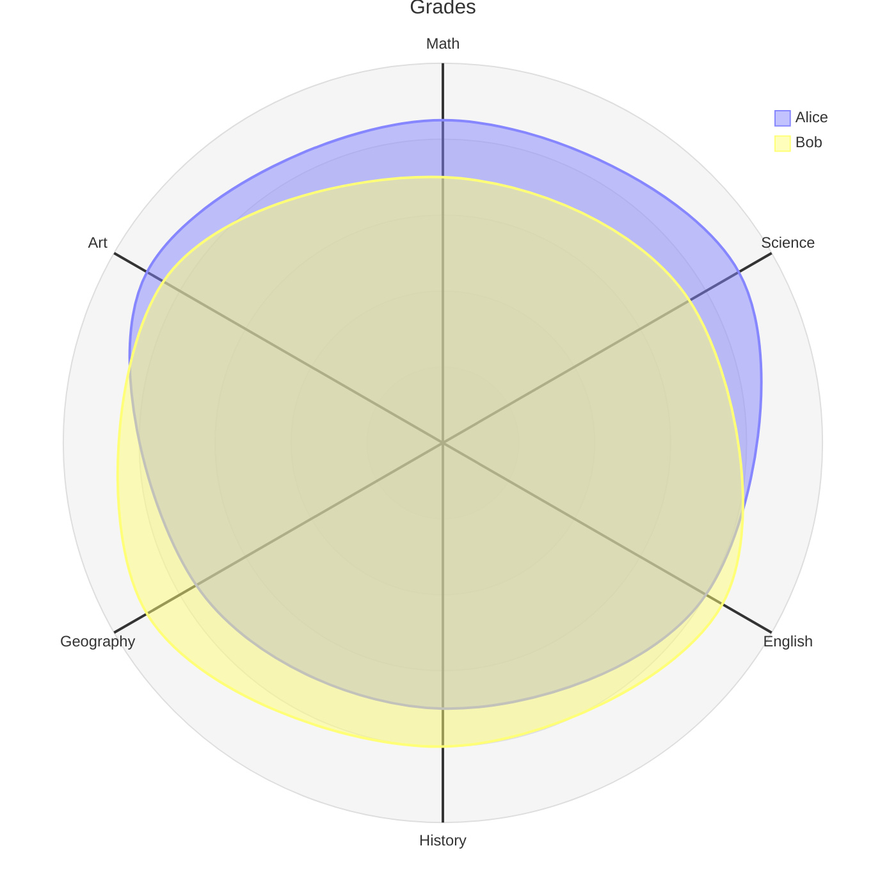
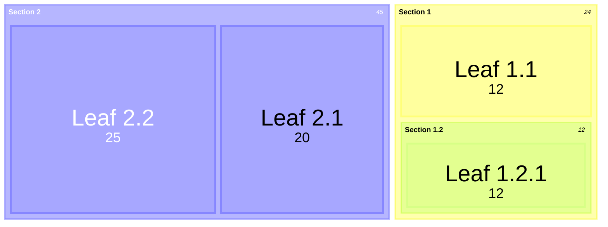

# Mermaid: git graphs, kanban boards, packets, radar charts and treemaps

Still more diagrams drawn natively, like the others in [20-mermaid-flowchart.md](20-mermaid-flowchart.md) to [26-mermaid-more.md](26-mermaid-more.md).

## Git graph

## Git graph, top to bottom

## Kanban

## Packet

## Radar chart

## Treemap

