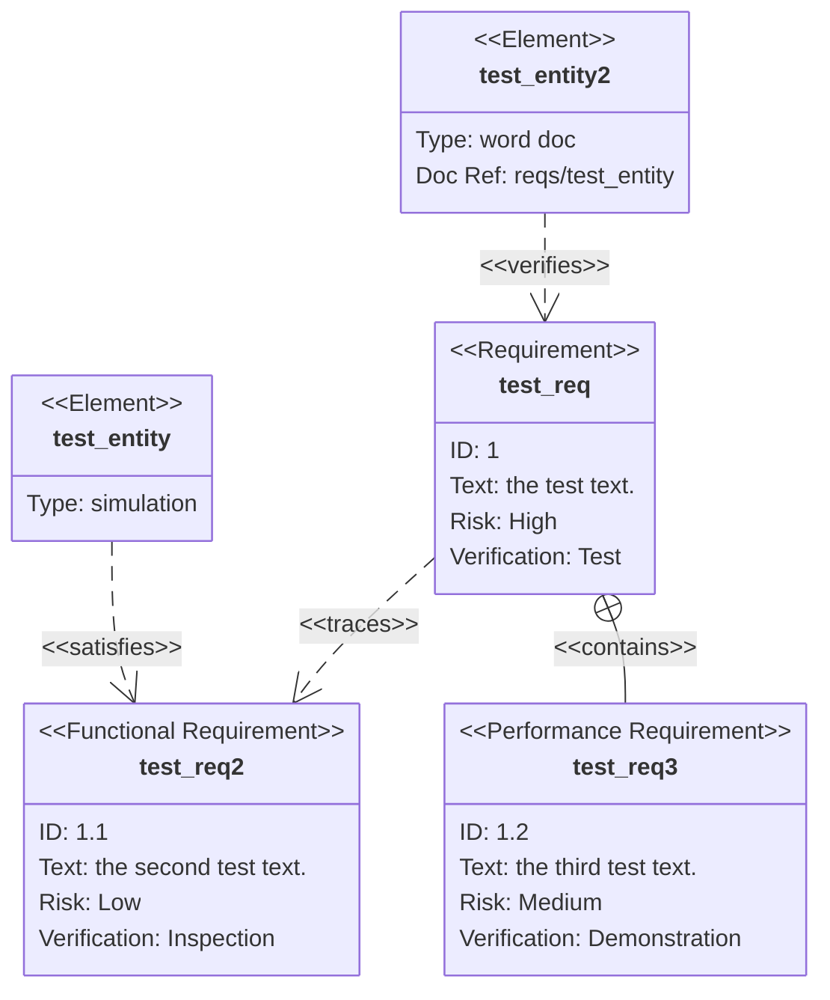
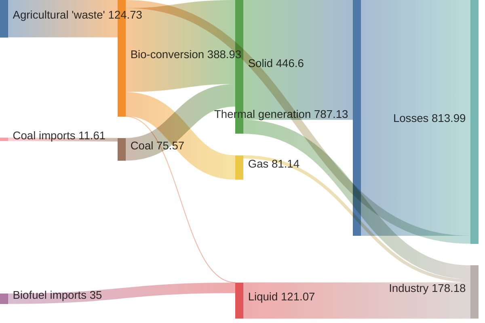
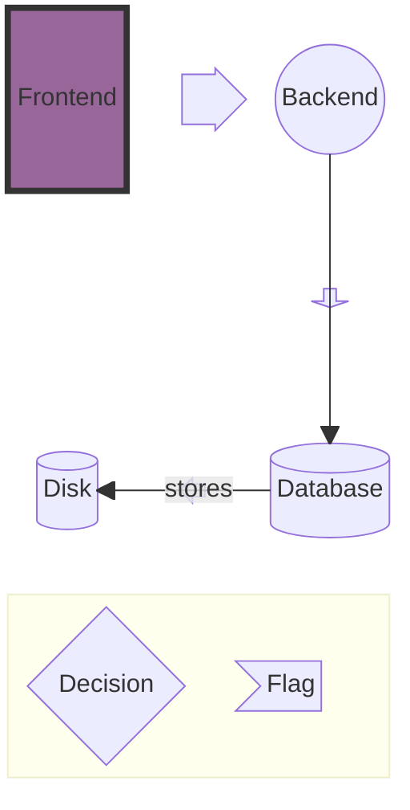
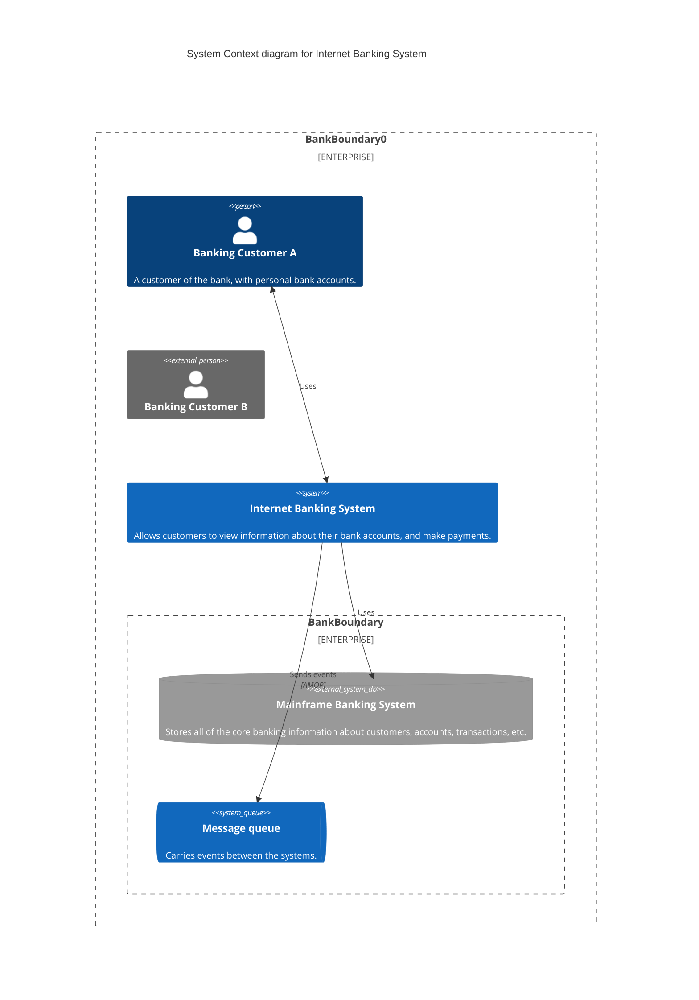
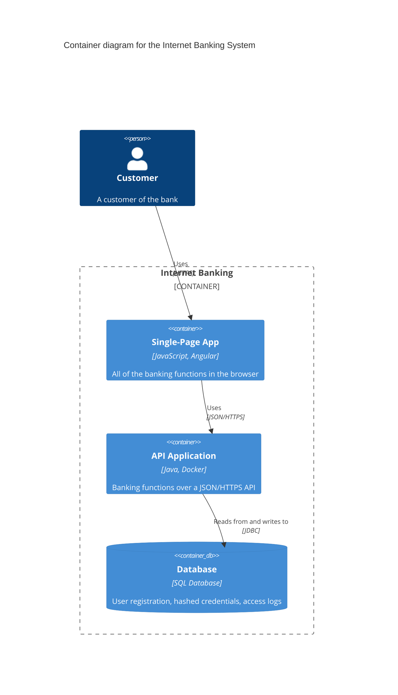
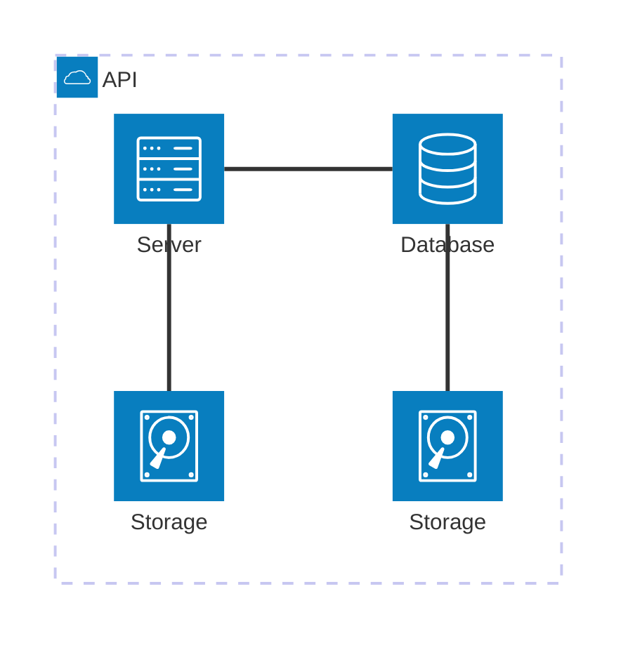

# Mermaid: requirement, sankey, block, C4 and architecture diagrams

The last Mermaid types drawn natively, like the others in [20-mermaid-flowchart.md](20-mermaid-flowchart.md) to [27-mermaid-git-kanban.md](27-mermaid-git-kanban.md).

## Requirement diagram

## Sankey diagram

## Block diagram

## C4 context diagram

## C4 container diagram

## Architecture diagram

## Architecture: junctions, arrows, labels, group edges

```mermaid
architecture-beta
    group public(internet)[Public]
    group private(cloud)[Private]

    service gateway(internet)[Gateway] in public
    service web "Web app"[Front end] in private
    service cache(disk)[Cache] in private
    service store(database)[Store] in private
    service other(logos:aws-s3)[From an icon pack]
    junction hub in private

    gateway{group}:B -[HTTPS]-> T:web{group}
    web:R --> L:hub
    hub:T -- B:cache
    hub:B -- T:store
    store:R <-[sync]-> L:other
```

