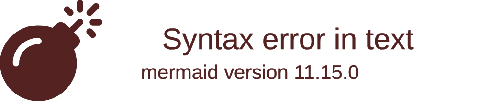
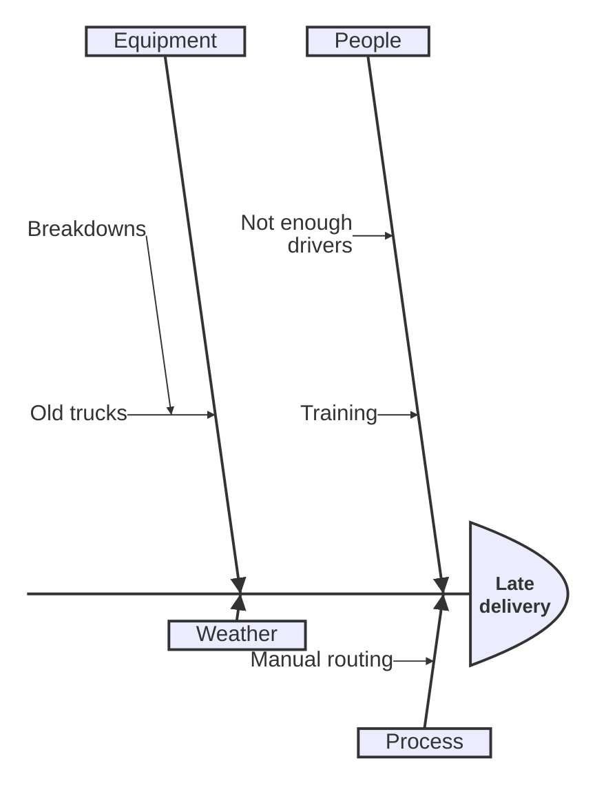
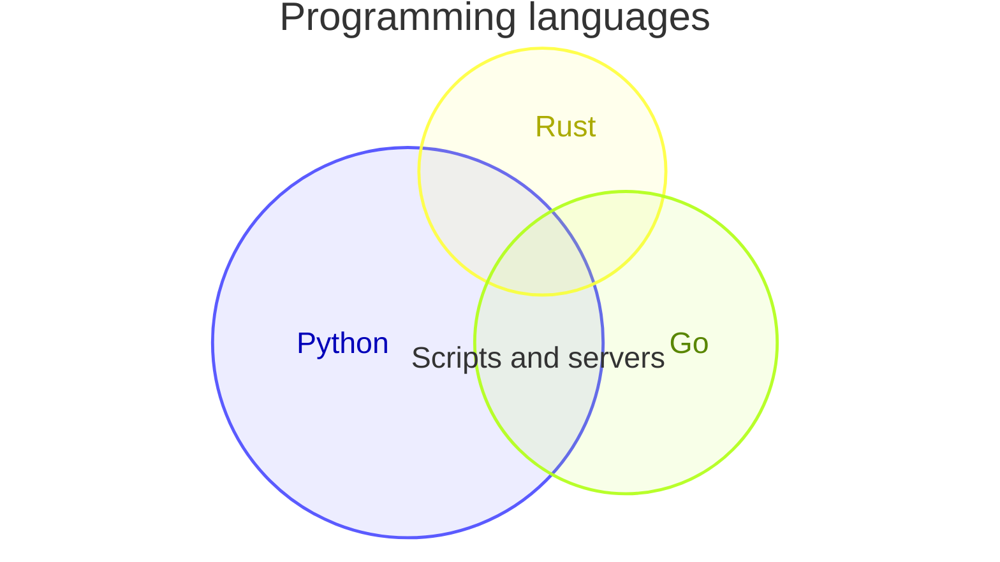
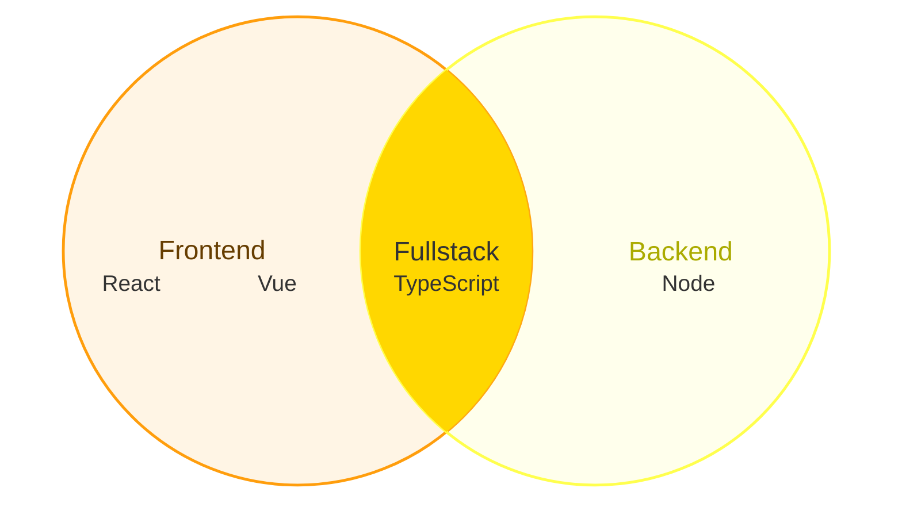
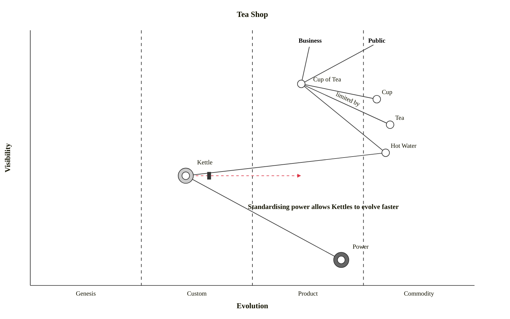
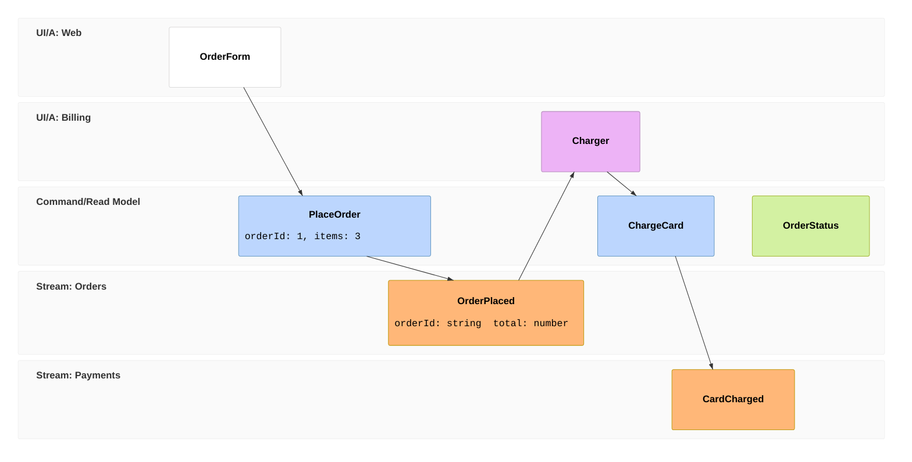

# Mermaid: beta diagram types

Mermaid's newest (beta) diagram types, drawn natively like the others in [20-mermaid-flowchart.md](20-mermaid-flowchart.md) to [28-mermaid-c4-architecture.md](28-mermaid-c4-architecture.md).

## Tree view



## Ishikawa (fishbone)



## Cynefin

```mermaid
cynefin-beta
  title Where our work sits
  complex
    "New product line"
  complicated
    "Tax rules"
    "Capacity planning"
  clear
    "Invoicing"
  chaotic
    "Outage"
  confusion
    "Reorganisation"
  chaotic --> complex : "stabilise"
  complex --> complicated : "learn"
```

## Venn





## Wardley map



## Railroad diagrams

```mermaid
railroad-beta
expr = sequence(nonterminal("term"), zeroOrMore(sequence(choice(terminal("+"), terminal("-")), nonterminal("term"))));
term = sequence(nonterminal("factor"), optional(choice(terminal("*"), terminal("/"))));
factor = choice(terminal("number"), sequence(terminal("("), nonterminal("expr"), terminal(")")));
```

```mermaid
railroad-ebnf-beta
value = object | array | string | number | "true" | "false" | "null" ;
object = "{" , [ member , { "," , member } ] , "}" ;
member = string ":" value ;
letter = ? any unicode letter ? - digit ;
```

```mermaid
railroad-abnf-beta
rulelist = 1*( rule / (*c-wsp c-nl) ) ;
digit = %x30-39 ;
opt = [ "a" ] 2"b" 3*5"c" ;
```

```mermaid
railroad-peg-beta
Sum <- Product (('+' / "-") Product)* ;
Value <- Number / "(" Sum ")" / !"x" . ;
```

## Event model



## Swimlanes

```mermaid
swimlane-beta LR
  subgraph Customer
    A[Place order] --> B{Paid?}
  end
  subgraph Shop
    C[Pack items] --> D[Ship]
  end
  subgraph Bank
    E[Charge card]
  end
  B -->|yes| C
  B -->|no| E
  E --> C
```

```mermaid
swimlane-beta TD
  subgraph Dev
    a[Write code] --> b[Open PR]
  end
  subgraph Review
    c[Review] --> d{OK?}
  end
  subgraph Ops
    e[Deploy]
  end
  b --> c
  d -->|yes| e
  d -->|no| a
```

## Info

```mermaid
info
```
